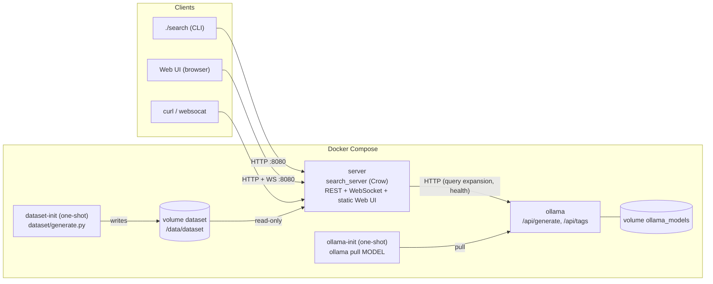

# Parallel Search Engine with LLM Query Expansion

A C++20 search engine built for the "Parallel Computing" coursework. It builds an
inverted index of a text corpus in parallel (own thread pool, own sharded concurrent
index), serves a REST API and a WebSocket pipeline, and uses a local LLM served by
Ollama to expand queries with keywords and synonyms. A search runs as
query expansion -> keyword search (TF-IDF scoring, boolean OR) and falls back to the
plain query when Ollama is not available.

Everything starts with one command: `docker compose up`.

The contract of every endpoint and message is [`docs/API.md`](docs/API.md). UML
diagrams are in [`docs/uml/`](docs/uml/README.md), the explanatory note is in
[`docs/report/`](docs/report/).

## Architecture



Inside `search_server`:

| Component | Role |
|---|---|
| `ApiServer` | HTTP routes, static files, `/ws/search` (Crow, `max(16, 2 x cores)` worker threads) |
| `SearchPipelineService` | index lifecycle (atomic snapshot swap), expansion -> search pipeline, per-connection WebSocket queue |
| `IndexBuilder` | walks the dataset, one task per document in a fresh `CustomThreadPool` |
| `CustomThreadPool` | own fixed-size worker pool (mutex + condition variables) |
| `InvertedIndex` | own concurrent index: 64 shards, each with its own `std::shared_mutex` |
| `OllamaClient` | `POST /api/generate` for expansion, cached `GET /api/tags` for health |

Compose services: `server`, `ollama`, `ollama-init` (one-shot), `dataset-init`
(one-shot), and the optional `bench` (profile `bench`).

## Requirements

- Docker with Compose v2 (`docker compose version`). Nothing else is needed on the
  host: the server is built, and the dataset is generated, inside containers.
- Network access on the first start (base images, C++ dependencies fetched by CMake,
  the Ollama model).
- Disk (estimate): the dataset volume is about 2.1 GB, plus the Ollama model, plus
  Docker images and the build cache; keep roughly 8 GB free.
- RAM: the index of the full dataset stays well below 1.5 GB resident
  (design note in `server/include/search/inverted_index.h`); the Ollama model needs
  additional memory (CPU inference, no GPU is passed into the container).

## Quick start

```bash
git clone <repository-url> course_work_parallel_computing
cd course_work_parallel_computing
docker compose up
```

What happens on the first start:

1. The `server` image is built from the root `Dockerfile` (multi-stage: GCC 13 build
   stage, slim runtime stage). CMake downloads the pinned dependencies (Crow, Asio,
   nlohmann/json, cpp-httplib) during the build.
2. `ollama` starts. `ollama-init` runs `ollama pull $OLLAMA_MODEL`
   (default `llama3.2:1b`) and exits. The server does **not** wait for the model: it
   works immediately with fallback expansion and switches to LLM expansion when the
   model is available. If the pull fails (offline), only a warning is printed.
3. `dataset-init` runs `dataset/generate.py` into the `dataset` volume: 20 000
   documents, about 2.1 GB, seed 42. It skips generation when the volume already
   holds a dataset with the same size, document count and seed. Generation time is
   not measured here; it depends on CPU cores and disk (the script uses all cores and
   prints progress).
4. `server` starts after `dataset-init` has finished successfully and listens on
   port 8080.

The server does **not** build an index on startup. You build it once with
`POST /api/index` (see First steps); until then searches return `503 index_not_built`.

The stack is ready when:

```bash
curl -s http://localhost:8080/api/health
# {"index_ready":false,"indexing":false,"ollama":false,"status":"ok"}
```

returns HTTP 200 (`docker compose ps` shows the `server` container as `healthy`).
`"ollama": true` appears when the model has finished downloading; follow it with
`docker compose logs -f ollama-init`.

## First steps

Build the index (synchronous; the response arrives when the new index is serving):

```bash
curl -s -X POST http://localhost:8080/api/index -H 'Content-Type: application/json' -d '{"threads": 4}'
# or
./search --index 4
```

Search:

```bash
curl -s -X POST http://localhost:8080/api/search -H 'Content-Type: application/json' \
     -d '{"query": "climate change effects", "mode": "keyword"}'
# or
./search "climate change effects"
```

Or open <http://localhost:8080>, press **Build index**, then search.

## Dataset

| Item | Value |
|---|---|
| Path in the server container | `/data/dataset` (`DATASET_PATH`), mounted read-only |
| Docker volume | `dataset` (the real name is prefixed by the Compose project name, see `docker volume ls`) |
| Format | one UTF-8 file ending in `.txt` per document, in 16 topic folders: `<topic>/doc_NNNNNN.txt` |
| `doc_id` | path relative to the dataset root, `/` separators, e.g. `cooking/doc_000963.txt` |
| Default size | 20 000 documents, about 2.1 GB (the assignment asks for >= 10 000 documents and >= 1 GB) |

Generator: `dataset/generate.py` (Python standard library only, deterministic for a
given seed). Text is made of English-like words from `dataset/vocab/` (16 topics plus
a general list) drawn with a Zipf-like distribution; document sizes vary +-50% around
`size / docs`. The marker file `.complete` (JSON with size, docs, seed) is written
last; with `--if-needed` the script exits at once if the marker matches the requested
values and otherwise wipes the target directory and regenerates. Details:
[`dataset/README.md`](dataset/README.md).

Variables (set them in the shell before `docker compose up`):

| Variable | Default | Meaning |
|---|---|---|
| `DATASET_SIZE_MB` | `2100` | total size in MB |
| `DATASET_DOCS` | `20000` | number of documents |
| `DATASET_SEED` | `42` | generator seed |

Smaller dataset for development (about 100 MB, 2000 documents):

```bash
DATASET_SIZE_MB=100 DATASET_DOCS=2000 docker compose up
```

Changing these values makes `dataset-init` wipe and regenerate the volume at the
next `docker compose up`. Generate a dataset outside Docker (for local runs):

```bash
python3 dataset/generate.py --out /tmp/ds100 --size-mb 100 --docs 2000
```

**Using your own corpus.** The indexer reads every `*.txt` file under
`DATASET_PATH` recursively (symbolic links are not followed). `dataset-init` would
overwrite a volume whose `.complete` marker does not match, so do not put your files
into the generated volume. Instead, mount your directory over `/data/dataset` and
switch the generator off, for example with a `docker-compose.override.yml` (standard
Compose merge rules; not run as part of this documentation):

```yaml
services:
  dataset-init:
    entrypoint: ["true"]
  server:
    volumes:
      - /absolute/path/to/your/corpus:/data/dataset:ro
```

Then call `POST /api/index` again. File changes become visible only after the next
index build.

## API

Full field-level contract: [`docs/API.md`](docs/API.md). Every response of
`/api/*` is JSON; errors have the shape `{"status":"error","code":...,"error":...}`.

| Method | Path | Purpose |
|---|---|---|
| `GET` | `/api/health` | liveness, Ollama availability, index state |
| `POST` | `/api/index` | rebuild the index in parallel, body `{"threads": N}` (1..64, optional) |
| `POST` | `/api/search` | query expansion + keyword search |
| `GET` | `/api/stats` | statistics of the last completed build |
| `WS` | `/ws/search` | streaming pipeline: `query_expansion` -> `keyword_search` -> `done` |

```bash
# health
curl -s http://localhost:8080/api/health
# {"index_ready":true,"indexing":false,"ollama":true,"status":"ok"}

# build the index with 4 worker threads
curl -s -X POST http://localhost:8080/api/index \
     -H 'Content-Type: application/json' -d '{"threads": 4}'
# {"documents_indexed":20000,"files_skipped":0,"status":"ok","threads_used":4,"time_ms":...}

# search (add "expand": false to skip Ollama, "limit": N for 1..100 results)
curl -s -X POST http://localhost:8080/api/search \
     -H 'Content-Type: application/json' \
     -d '{"query": "recipe oven", "mode": "keyword", "limit": 3}'
# {"expanded_terms":[...],"expansion":"llm"|"fallback"|"disabled","results":[{"doc_id":...,"score":1.0,"snippet":...}],
#  "search_time_ms":...,"time_ms":...,"total_matches":...}

# statistics
curl -s http://localhost:8080/api/stats
# {"documents":20000,"index_build_time_ms":...,"index_ready":true,"indexing":false,"threads_used":4,"unique_terms":...}
```

WebSocket (the connection stays open; every query gets its own sequence, queries of
one connection are processed in order):

```bash
websocat ws://localhost:8080/ws/search
```

```text
> {"query": "climate change"}
< {"stage":"query_expansion","data":{"original":"climate change","expanded_terms":[...],"expansion":"llm","time_ms":...}}
< {"stage":"keyword_search","data":{"results":[...],"time_ms":...,"total_matches":...}}
< {"stage":"done"}
```

The same exchange from a script:
`echo '{"query": "climate change"}' | timeout 60 websocat -n ws://localhost:8080/ws/search`.

## CLI

`./search` is a bash wrapper (REST only). By default it runs `/app/search_cli`
inside the running `server` container (`docker compose exec -T server ...`), so
nothing has to be installed on the host. If the container is not running and
`build/cli/search_cli` exists (local CMake build), it uses that binary instead.
`SEARCH_CLI_LOCAL=/path/to/search_cli` forces a specific binary.

```text
./search [options] "query words"
```

| Option | Meaning |
|---|---|
| `--host H` | server host (default `localhost`) |
| `--port P` | server port (default `$PORT`, else `8080`) |
| `--limit N` | number of results, 1..100 (server default 10) |
| `--no-expand` | skip LLM expansion (sends `"expand": false`) |
| `--json` | print the raw response body and nothing else |
| `--index [N]` | build the index (`POST /api/index`), optionally with `N` threads (1..64) |
| `--stats` | show index statistics (`GET /api/stats`) |
| `--health` | show server health (`GET /api/health`) |
| `--timeout S` | read timeout in seconds (default 120; 3600 for `--index`) |
| `--help` | show help |

Give either a query or exactly one of `--index`, `--stats`, `--health`. Exit codes:
`0` ok, `1` usage error, `2` server, API or network error.

Sample output (real run of the local binary against a 2000-document development
dataset with Ollama unreachable, so the expansion falls back; output on a terminal
of 100 columns):

```text
$ ./search --index 4
Index built: 2000 documents in 633 ms using 4 threads

$ ./search --stats
Documents:        2000
Unique terms:     16656
Last build time:  633 ms
Threads used:     4
Index ready:      yes
Indexing now:     no

$ ./search --health
Server:   ok
Ollama:   not ready
Index:    ready
Indexing: no

$ ./search "recipe oven" --limit 3
Query: recipe oven
Expanded terms (fallback): recipe, oven

 1. [1.00] cooking/doc_000963.txt
      ... doughs knife sugar-pot. 245 bread-bowl carrot-herb gooding oven if cream-onion model v36
      came pasta museum salting for ring caughting. Recipe house pies ingredient model n832 knifer
      flavor-lunch to. ...

 2. [1.00] cooking/doc_001379.txt
      That Bake-cup Or Recipe That bake-cup or recipe ingredient thyming plate ovener bread-dinner
      ingredient which pepper ingredient cooker knife-cup. Oven delicious model c462 its model q732
      sure milk lay...

 3. [0.99] cooking/doc_001251.txt
      ...k Pots Spooned On Milk pots spooned on pepper bowl that top recipe recipe kitchen recipe
      fork ingredient kitchening ingredienter pepper-cheese recipe oranger to...

total_matches: 899 | search 1 ms | total 1 ms

$ ./search --no-expand --limit 2 "zzqxjv"
Query: zzqxjv
Expanded terms (disabled): zzqxjv

No results.
total_matches: 0 | search 0 ms | total 0 ms

$ ./search --json --no-expand --limit 1 garden
{"expanded_terms":["garden"],"expansion":"disabled","results":[{"doc_id":"gardening/doc_000503.txt","score":1.0,"snippet":"..."}],"search_time_ms":0,"time_ms":0,"total_matches":1897}

$ ./search "climate change"          # before the first build
error: index_not_built: index is not built; call POST /api/index first
hint: build the index first, e.g. ./search --index 4
```

Snippets are cut to three lines per result; in the `--json` sample the snippet is
shortened to `...` here. Before the first build `--health` prints `Index:    not built`.

**Windows:** use `search.cmd "query"` from `cmd` or PowerShell. It requires Docker
Desktop and a running `server` container (`docker compose up -d`) and runs the CLI
inside the container; set `SEARCH_CLI_LOCAL` to use a local `search_cli.exe` instead.
Quote the query.

## Web UI

Open <http://localhost:8080>. The page is served by `search_server` itself (static
files from `WEB_ROOT`, default `/app/web`; plain HTML/JS, no dependencies). It shows:

- **Search**: query field, result limit, a checkbox for LLM expansion, and the
  WebSocket connection state. Searches go over `/ws/search`.
- **Pipeline**: the three stages `query_expansion`, `keyword_search`, `done`, each
  with its state (pending / active / complete / failed) and time in ms, the
  expansion source (`llm`, `fallback`, `disabled`) and the expanded terms as chips
  (original terms vs terms added by the LLM).
- **Results**: ranked list with score, `doc_id` and the snippet with query terms
  highlighted.
- **Admin**: server, Ollama, index state and statistics (from `/api/health` and
  `/api/stats`), a thread count field and the **Build index** button
  (`POST /api/index`), and **Refresh**.

## Configuration

Server variables (full table: `docs/API.md` section 12). An unset or empty variable
keeps its default; a malformed number stops the server with exit code 2.

| Variable | Default | Meaning |
|---|---|---|
| `PORT` | `8080` | HTTP and WebSocket port (1..65535); the CLI also reads it |
| `DATASET_PATH` | `/data/dataset` | dataset root |
| `OLLAMA_URL` | `http://ollama:11434` | base URL of Ollama |
| `OLLAMA_MODEL` | `llama3.2:1b` | model for `/api/generate`, checked by `/api/health` |
| `OLLAMA_TIMEOUT_MS` | `15000` | timeout of one expansion call (> 0) |
| `WEB_ROOT` | `/app/web` | directory of the Web UI |

`docker-compose.yml` takes these from the host shell: `PORT`, `OLLAMA_MODEL`,
`OLLAMA_TIMEOUT_MS`, `DATASET_SIZE_MB`, `DATASET_DOCS`, `DATASET_SEED`. The compose
file fixes `DATASET_PATH=/data/dataset`, `OLLAMA_URL=http://ollama:11434` and
`WEB_ROOT=/app/web` for the `server` service. Example:
`OLLAMA_MODEL=llama3.2:3b PORT=9000 docker compose up`.

## Development

Requirements: a C++20 compiler (GCC 13 is used in the image), CMake >= 3.20, git
(dependencies are fetched by CMake at configure time).

```bash
cmake -S . -B build
cmake --build build -j
ctest --test-dir build --output-on-failure
```

Targets: `search_core` (static library: thread pool, tokenizer, index, snippets,
builder), `search_service` (static library: HTTP/WS/Ollama layer), `search_server`,
`search_cli`, and the test executables `core_tests` and `service_tests`
(GoogleTest). `index_bench` (not built by default) prints build time, peak RSS and
search latency for a directory:
`cmake --build build --target index_bench && build/server/index_bench DIR THREADS [query ...]`.

Run a local server against a small dataset:

```bash
python3 dataset/generate.py --out /tmp/ds100 --size-mb 100 --docs 2000
PORT=8080 DATASET_PATH=/tmp/ds100 WEB_ROOT=$PWD/web build/server/search_server
./search --index 4        # uses build/cli/search_cli when no container is running
```

ThreadSanitizer build (`ENABLE_TSAN` instruments everything including GoogleTest):

```bash
cmake -S . -B build/tsan -DENABLE_TSAN=ON
cmake --build build/tsan -j
build/tsan/server/core_tests
build/tsan/server/service_tests
```

Formatting: C++ uses `.clang-format` (`BasedOnStyle: Google`):

```bash
clang-format -i $(git ls-files '*.cpp' '*.h')
```

Python helper scripts are formatted with `black`.

## Benchmarks

Start the stack with the full dataset and wait until `/api/health` shows
`"ollama": true` (otherwise the expansion run only measures the fallback path), then:

```bash
docker compose up -d --build
docker compose --profile bench run --rm bench            # full run
docker compose --profile bench run --rm bench --quick    # smoke test
```

The `bench` container installs matplotlib and talks to `http://server:PORT`. Results
are written to `bench/results/` (CSV files, `REPORT.md`, `environment.json`) and
charts to `bench/charts/` (`index_time_vs_threads.png`, `speedup_efficiency.png`,
`throughput_vs_clients.png`, `latency_vs_clients.png`). The first index build after
the stack starts can be slower because the dataset files are not yet in the page
cache; the benchmark therefore does one untimed warm-up build before the timed ones.
Options, a host-Python variant and method notes: [`bench/README.md`](bench/README.md);
bottleneck discussion: [`bench/ANALYSIS.md`](bench/ANALYSIS.md).

## Project structure

```
CMakeLists.txt            root build file (adds server/ and cli/)
Dockerfile                multi-stage image: /app/search_server, /app/search_cli, /app/web
docker-compose.yml        server, ollama, ollama-init, dataset-init, bench (profile)
search, search.cmd        CLI entry scripts (Linux/macOS, Windows)
server/include/search/    headers (design notes at the top of each)
server/src/               thread pool, tokenizer, index, snippets, builder,
                          Ollama client, pipeline service, API server, main
server/tests/             GoogleTest suites (core_tests, service_tests)
server/tools/             index_bench (optional)
cli/src/main.cpp          search_cli
web/                      static Web UI (index.html, app.js, style.css)
dataset/                  generate.py, vocab.py, vocab/*.txt (data lives in a Docker volume)
bench/                    run_all.py, loadgen.py, plot.py, report.py, results/, charts/
docs/API.md               REST + WebSocket contract
docs/uml/                 PNG diagrams + README.md with Mermaid diagrams
docs/report/              explanatory note (Ukrainian) and PDF instructions
docs/prompts.md           log of the AI prompts used during development
docs/assignment/          the task description (PDF)
```

## Troubleshooting

- **`"ollama": false` in `/api/health`.** The model is still downloading
  (`docker compose logs -f ollama-init`), the model name does not match
  `OLLAMA_MODEL`, or Ollama is down. The server keeps working: searches use the
  original query tokens and report `"expansion": "fallback"`.
- **`503 index_not_built`.** No index has been built since the server started. Call
  `POST /api/index` (or `./search --index 4`). The index lives in memory, so it must
  be rebuilt after every server restart.
- **Port 8080 is busy.** Choose another host port: `PORT=8081 docker compose up`
  (host and container use the same number); use `./search --port 8081 ...` outside
  the container or the Web UI at the new port.
- **Regenerate the dataset.** Change `DATASET_SIZE_MB`, `DATASET_DOCS` or
  `DATASET_SEED` and run `docker compose up` (the marker no longer matches, so the
  volume is wiped and regenerated), or remove the volume as below.
- **Remove volumes and start clean.** `docker compose down -v` deletes the `dataset`
  and `ollama_models` volumes (the dataset is regenerated and the model pulled again
  on the next start). `docker compose down` alone keeps them.
- **`./search` says the `server` container is not running.** Start it with
  `docker compose up -d`, or build the CLI locally
  (`cmake -S . -B build && cmake --build build --target search_cli`).
