# Пояснювальна записка

**Курсова робота з дисципліни «Паралельні обчислення»**

**Тема:** дослідження та реалізація паралельних обчислень на прикладі побудови
пошукової системи з інтеграцією LLM.

Виконавець: [ЗАПОВНИТИ: ПІБ, група]
Посилання на репозиторій: https://github.com/Stalkeroid/OP_Course

---

## 1. Вступ

### 1.1. Мета роботи

Дослідити та реалізувати паралельні обчислення на прикладі пошукової системи: інвертований
індекс будується паралельно за допомогою власного пулу потоків і власної потокобезпечної
структури даних, кілька клієнтів обробляються одночасно, а пошукові запити
розширюються ключовими словами та синонімами за допомогою локально розгорнутої великої
мовної моделі (Ollama).

### 1.2. Постановка задачі

Згідно із завданням система має:

1. запускатися однією командою `docker compose up`; Docker Compose містить сервіс
   пошукового сервера та сервіс Ollama; сервер надає `GET /api/health`;
2. будувати інвертований індекс паралельно, з власним пулом потоків і власною
   структурою даних для індексу, з можливістю змінювати кількість потоків;
3. надавати фіксований REST API: `GET /api/health`, `POST /api/index` (параметр
   `threads`), `POST /api/search` (параметри `query` та `mode: keyword`),
   `GET /api/stats`; формат відповідей — JSON;
4. розширювати запит через Ollama `/api/generate`;
5. передавати пайплайн пошуку через WebSocket `/ws/search` повідомленнями
   `query_expansion`, `keyword_search`, `done`;
6. мати два клієнти: консольний (`./search "запит"`) і веб-інтерфейс;
7. працювати з текстовим датасетом: не менше 10 000 англомовних документів і не менше
   1 ГБ (у завданні також згадано 2 ГБ; датасет за замовчуванням — 2100 MiB (близько 2,2 ГБ), що задовольняє обидві вимоги);
8. мати графіки залежності часу побудови індексу від кількості потоків і
   пропускної здатності від кількості клієнтів, аналіз вузьких місць, UML-діаграми та
   історію комітів у Git.

Повна специфікація інтерфейсу винесена в окремий документ `docs/API.md`; код, клієнти та
README перевіряються на відповідність йому. Нижче на нього посилаються як на «контракт».

### 1.3. Обрані технології та обґрунтування

| Технологія | Для чого | Чому |
|---|---|---|
| C++20 | бекенд | компільована мова (вимога завдання), прямий доступ до потоків, м'ютексів і атомарних операцій стандартної бібліотеки |
| CMake ≥ 3.20 + `FetchContent` | збірка | залежності завантажуються з фіксованих тегів, тому свіжий клон збирається в Docker без ручних кроків |
| Crow 1.3.5 (+ standalone Asio) | HTTP і WebSocket сервер | один компактний header-only бібліотечний фреймворк для REST і WebSocket; багатопотокова обробка запитів |
| nlohmann/json 3.12 | JSON | зручна та надійна розбірка і серіалізація |
| cpp-httplib 0.27 | HTTP-клієнт до Ollama та CLI | header-only, достатньо для двох синхронних викликів |
| GoogleTest 1.15 | тести | стандарт для C++ |
| Ollama (`llama3.2:1b` за замовчуванням) | розширення запитів | локальна LLM без зовнішніх ключів; невелика модель працює на CPU |
| Docker Compose | розгортання | вимога завдання; окремі сервіси для сервера, Ollama та одноразових ініціалізаторів |
| Python 3 (стандартна бібліотека, matplotlib) | генератор датасету, бенчмарки | допоміжні скрипти, не частина сервера |
| Vanilla JS | Web UI | без залежностей і етапу збірки |

Пул потоків і інвертований індекс написані самостійно: бібліотечні пули потоків і
конкурентні контейнери для цих двох компонентів не використовуються (вимога завдання).

---

## 2. Модель системи

Модель системи подано діаграмами UML, що зберігаються в `docs/uml/`: діаграмою варіантів
використання, діаграмою класів, діаграмами послідовності (по одній на кожен варіант
використання) та діаграмою розгортання.

### 2.1. Діаграма варіантів використання

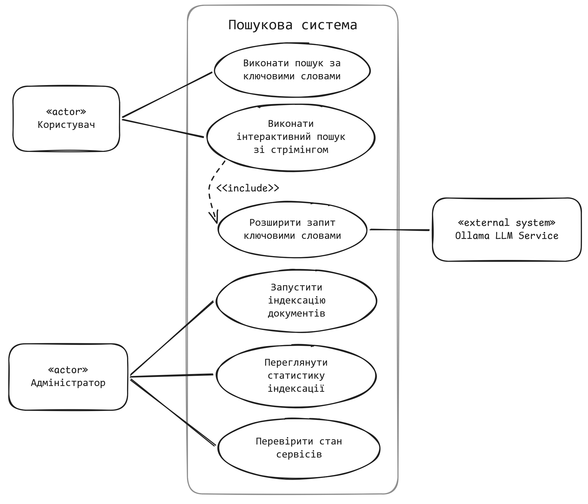

*Рисунок 2.1 — Діаграма варіантів використання*

Актори: Користувач, Адміністратор і зовнішня система Ollama LLM Service. Варіанти
використання та відповідні кінцеві точки:

| Актор | Варіант використання | Кінцева точка |
|---|---|---|
| Користувач | Виконати пошук за ключовими словами | `POST /api/search` |
| Користувач | Виконати інтерактивний пошук зі стрімінгом | `WS /ws/search` |
| Адміністратор | Запустити індексацію документів | `POST /api/index` |
| Адміністратор | Переглянути статистику індексації | `GET /api/stats` |
| Адміністратор | Перевірити стан сервісів | `GET /api/health` |

Варіант «Розширити запит ключовими словами» підключається (`<<include>>`) до
інтерактивного пошуку зі стрімінгом і виконується зовнішньою системою Ollama LLM Service.

### 2.2. Діаграма класів

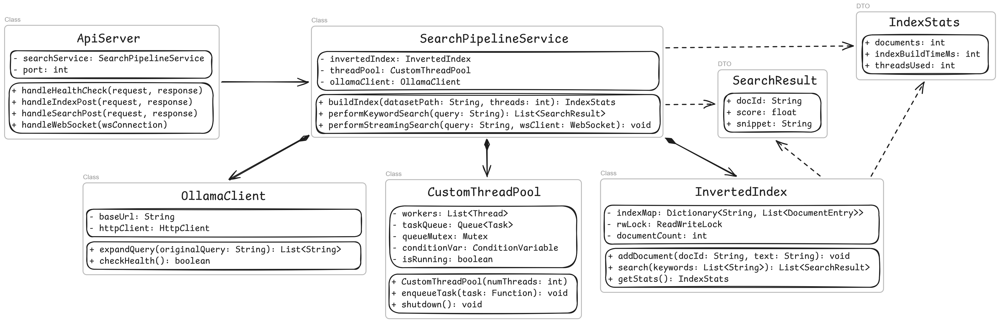

*Рисунок 2.2 — Діаграма класів*

- `ApiServer` — точка входу HTTP і WebSocket: маршрутизує запити до сервісу та формує
  відповіді в форматі контракту.
- `SearchPipelineService` — оркестратор: керує побудовою індексу, виконує пошук і
  стрімінговий конвеєр «розширення запиту, пошук, завершення». Складається (композиція) з
  `OllamaClient`, `CustomThreadPool` та `InvertedIndex`.
- `OllamaClient` — HTTP-клієнт до Ollama (`/api/generate`, `/api/tags`); у разі
  недоступності повертає порожній результат, і сервіс переходить на резервну гілку.
- `CustomThreadPool` — власний пул потоків із чергою завдань (`enqueueTask`).
- `InvertedIndex` — власний конкурентний інвертований індекс (`addDocument`, `search`,
  статистика).
- `SearchResult` та `IndexStats` — об'єкти передачі даних для результатів пошуку та
  статистики індексації.

Реалізація додає допоміжні класи: `IndexBuilder` (обхід датасету та побудова індексу
пулом потоків), `Config` (налаштування зі змінних середовища) і `WebSocketSession`
(черга запитів одного з'єднання).

### 2.3. Діаграми послідовності

Для кожного варіанта використання наведено окрему діаграму послідовності.

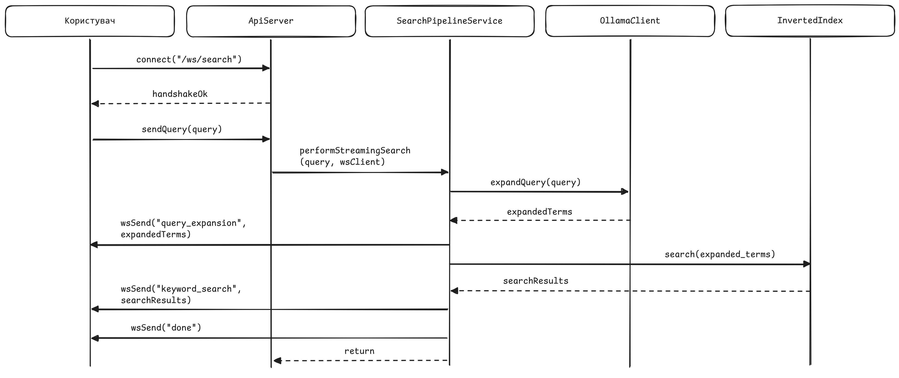

*Рисунок 2.3 — Діаграма послідовності: інтерактивний пошук зі стрімінгом (`WS /ws/search`)*

Клієнт надсилає запит через WebSocket; сервер спочатку передає повідомлення
`query_expansion` (терміни від LLM або резервний результат), потім виконує пошук в індексі
і надсилає `keyword_search`, а завершує потік повідомленням `done`. Запити одного
з'єднання обробляються послідовно, різних з'єднань — паралельно (розділ 3.7).

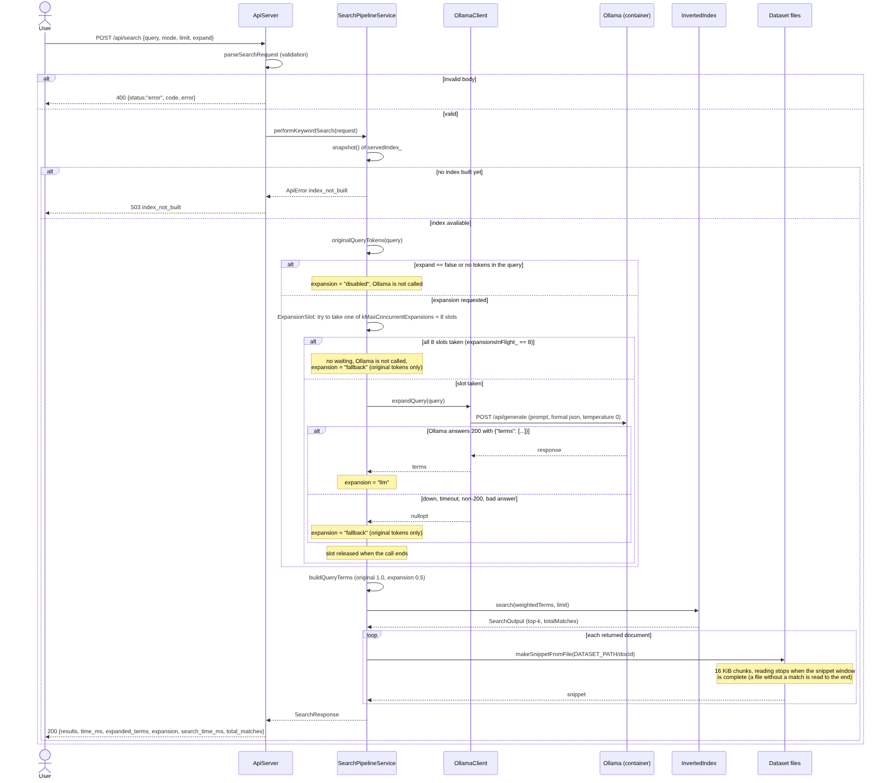

*Рисунок 2.4 — Діаграма послідовності: пошук за ключовими словами (`POST /api/search`)*

Після перевірки тіла запиту сервіс бере знімок індексу (якщо індексу немає, повертається
503), за потреби розширює запит через Ollama (за недоступності або вичерпання слотів
використовується резервна гілка лише з вихідними термінами), шукає в індексі з вагами
термінів і для кожного знайденого документа формує сніпет із файлу.

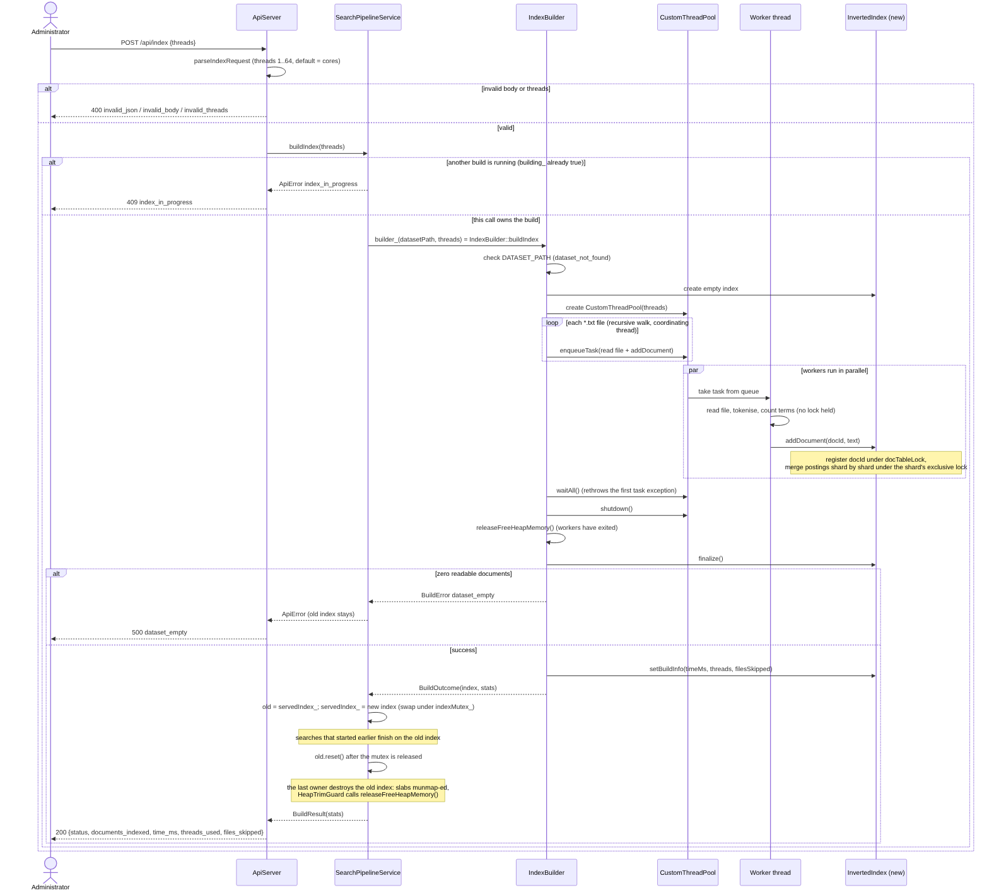

*Рисунок 2.5 — Діаграма послідовності: побудова індексу (`POST /api/index`)*

`IndexBuilder` створює пул потоків із заданою кількістю потоків і ставить у чергу завдання
на кожен файл; робочі потоки читають і токенізують файли без блокувань, а в індекс
вносять результат, блокуючи лише потрібний шард. Після завершення всіх завдань новий
індекс атомарно замінює попередній; пошуки, що вже почалися, дообслуговуються на старому.
Паралельна друга побудова відхиляється з кодом 409.

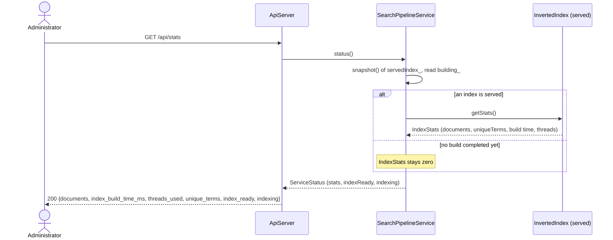

*Рисунок 2.6 — Діаграма послідовності: статистика індексації (`GET /api/stats`)*

Сервіс читає знімок поточного індексу та повертає кількість документів, час побудови,
кількість використаних потоків та прапорці `index_ready` і `indexing`. Якщо побудови ще не
було, статистика нульова.

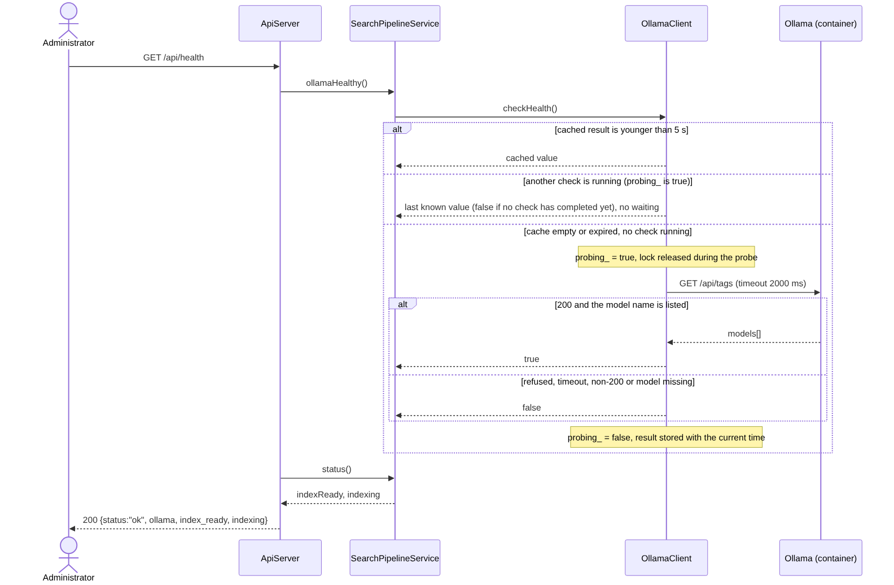

*Рисунок 2.7 — Діаграма послідовності: стан сервісів (`GET /api/health`)*

Стан Ollama перевіряється запитом `GET /api/tags` із коротким тайм-аутом, а результат
кешується на 5 секунд; одночасно виконується не більше однієї перевірки. Тому відповідь
`200` приходить одразу навіть тоді, коли Ollama недоступна (`"ollama": false`).

### 2.4. Діаграма розгортання

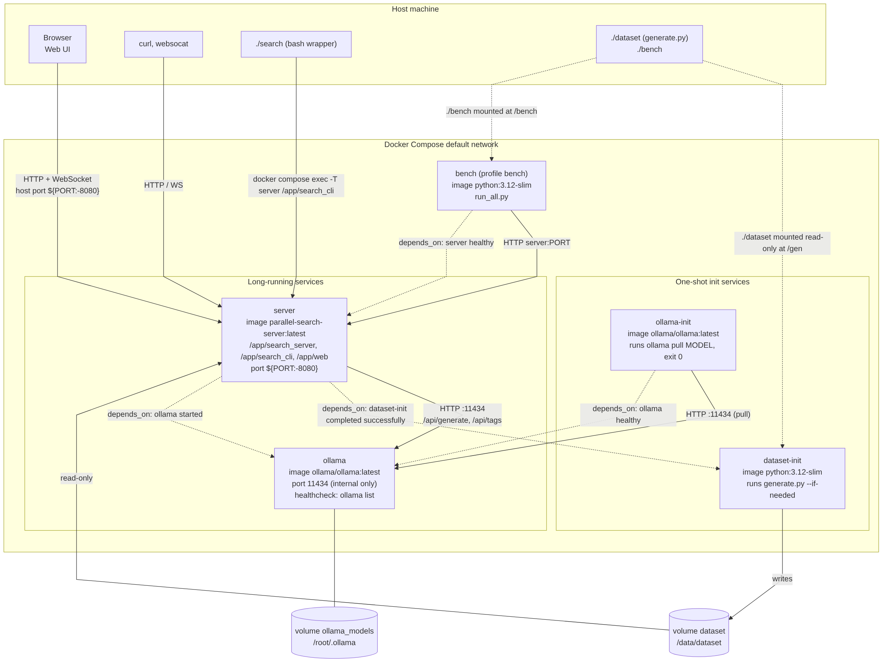

*Рисунок 2.8 — Діаграма розгортання (за `docker-compose.yml`)*

Сервіси Compose:

- `server` — образ, зібраний із кореневого `Dockerfile`; єдиний сервіс з опублікованим
  портом (`${PORT:-8080}`); читає том `dataset` лише для читання;
- `ollama` — образ `ollama/ollama`, порт 11434 доступний тільки всередині мережі Compose,
  модель зберігається в томі `ollama_models`;
- `ollama-init` — одноразовий контейнер, який виконує `ollama pull` моделі та завершується
  з кодом 0, навіть якщо завантаження не вдалося;
- `dataset-init` — одноразовий контейнер, який запускає `dataset/generate.py --if-needed`
  і записує датасет у том `dataset`;
- `bench` — необов'язковий сервіс (профіль `bench`) для вимірювань.

`server` залежить від успішного завершення `dataset-init` і від *запуску* `ollama`
(`service_started`), але не від завантаження моделі: `/api/health` повертає 200 з
`"ollama": false`, поки модель не готова.

---

## 3. Опис реалізації

### 3.1. Архітектура

```
 клієнти (CLI, браузер, curl)
          │ HTTP / WebSocket
 ┌────────▼───────────────────────────────────────────────┐
 │ ApiServer (Crow)                                       │
 │   маршрути /api/*, статичні файли, /ws/search          │
 └────────┬───────────────────────────────────────────────┘
          │
 ┌────────▼───────────────────┐       ┌──────────────────┐
 │ SearchPipelineService      │──────►│ OllamaClient     │──► Ollama
 │  знімок індексу, пайплайн, │       └──────────────────┘
 │  WebSocket-пул і черги     │
 └───┬─────────────────┬──────┘
     │ buildIndex      │ search
 ┌───▼───────────┐ ┌───▼──────────────────────────────┐
 │ IndexBuilder  │ │ InvertedIndex (64 шарди)         │
 │ + CustomThread│►│ shared_mutex на шард             │
 │   Pool        │ └──────────────────────────────────┘
 └───────────────┘
```

Код розділено на дві статичні бібліотеки. `search_core` (пул потоків, токенізатор,
інвертований індекс, сніпети, `IndexBuilder`) не залежить від HTTP, JSON і Ollama, тому
тестується окремо (`core_tests`). `search_service` (конфігурація, валідація запитів,
`OllamaClient`, `SearchPipelineService`, `ApiServer`) використовує сторонні бібліотеки
(`service_tests`). Обробники `ApiServer` приймають і повертають звичайні рядки, а Crow
використовується лише в `run()` і `handleWebSocket()`, тому HTTP-логіка тестується без сокетів.

Сервер обробляє запити в багатопотоковому режимі Crow: кількість потоків вводу-виводу
`max(16, 2 × кількість ядер)`. Кожне TCP-з'єднання на весь свій час життя прив'язується
бібліотекою до одного з цих потоків, і обробник маршруту REST (зокрема `POST /api/search`
та `POST /api/index`) виконується в потоці свого з'єднання. Кількість потоків більша за
мінімум навмисно: обробники, що блокуються (побудова індексу, виклик Ollama), займають
лише частину потоків, тому `/api/health` і `/api/stats` зазвичай відповідають одразу.
Водночас це має наслідок: з'єднання, яке опинилось на зайнятому потоці, чекає (відоме
обмеження L1, розділ 4.7 і контракт, розділ 2.5). WebSocket-запити виконуються не в
потоках вводу-виводу, а в окремому пулі (розділ 3.7).

### 3.2. Токенізація, оцінювання та сніпети

Правила токенізації та оцінювання спільні для побудови індексу й обробки запитів (одна
реалізація в `tokenizer.h`), і вони описані в контракті (розділ 4).

**Токенізація.** Символ токена — ASCII-літера або цифра; будь-який інший байт, зокрема
всі байти ≥ 0x80, є роздільником. Токен — найдовша послідовність таких символів у
нижньому регістрі. Токени довжиною менше 2 або більше 64 символів і 33 стоп-слова
відкидаються. Стемінг і лематизації немає (рішення замовника: `running` і `run` — різні
терміни). Токенізатор проходить буфер один раз і переводить токен у нижній регістр у
64-байтовий буфер на стеку, тому для кожного токена не виконується виділення пам'яті в купі.

**Терміни запиту.** `O` — токени запиту без дублікатів (до 32); `L` — токени від LLM без
дублікатів і без тих, що вже є в `O` (до 16). `expanded_terms = O + L`; вага термінів
`O` дорівнює 1,0, термінів `L` — 0,5. Пошук — булеве OR: документ підходить, якщо містить
хоча б один термін.

**Оцінювання (TF-IDF).**

```
tf(t,d)  = 1 + ln(c(t,d))
idf(t)   = ln(1 + N / df(t))
raw(d)   = Σ w(t) · tf(t,d) · idf(t)
score(d) = raw(d) / max raw(d')        (округлення до 6 знаків, діапазон (0, 1])
```

Результати сортуються за `raw` спадно, за рівності — за `doc_id` зростаюче. Тому
результат не залежить від кількості потоків і порядку вставки документів (перевіряється
тестом `DeterminismTest`). Для вибору перших `limit` документів використовується
обмежена купа розміром `limit`, а не сортування всіх збігів.

**Сніпет** (контракт, розділ 4.6) формується під час запиту із самого файлу документа:
текст нормалізується (некоректний UTF-8 замінюється на U+FFFD, послідовності пробільних
символів згортаються в один пробіл), вікно в 200 символів починається за 60 символів до
першого токена, що є серед `expanded_terms`; з обрізаних боків додається «...». Тому
сніпет має не більше 206 символів Unicode. Тексти документів в індексі не зберігаються —
це економить пам'ять; ціна — читання файлу на кожен повернутий результат.

Файл читається потоково (`makeSnippetFromFile`, `server/src/snippet.cpp`): шматками по
16 КіБ, які подаються в скінченний автомат (декодер UTF-8 → нормалізація пробілів →
відстеження токенів із кільцевим буфером останніх 256 символів). Читання припиняється,
щойно результат визначений: знайдено перший збіг, вікно в 200 символів після нього
заповнене і відомо, що за ним є ще принаймні один символ (від цього залежить завершальне
«...»). Тому довгий документ із ранім збігом не читається до кінця. Файл без жодного збігу
читається до кінця, бо відсутність збігу відома лише в кінці файлу; для нього вікно
береться з позиції 0. Пам'ять на виклик не залежить від розміру файлу. Результат
збігається з еталонною реалізацією на цілому тексті (тести `StreamingMatchesReference*`,
`FileVariantMatchesReferenceWithTinyChunks`, `StopsReadingAfterEarlyMatch`).

### 3.3. Інвертований індекс

Клас `InvertedIndex` — власна потокобезпечна структура. Вимоги до неї: під час
побудови багато потоків одночасно додають документи (багато записувачів), після
побудови багато клієнтів одночасно шукають (багато читачів).

**Шардування.** Словник термінів розділено на 64 шарди за хешем терміна (множення
Фібоначчі, беруться старші 6 бітів, щоб вибір шарда не залежав від молодших бітів,
якими користується `unordered_map`). Кожен шард (`alignas(64)`, щоб сусідні шарди не
ділили кеш-лінію) має власний `std::shared_mutex rwLock`, власну хеш-таблицю термінів і
власну арену постингів.

**Блокування.**

- `addDocument(docId, text)` спочатку токенізує текст і рахує частоти термінів у
  локальній для потоку таблиці (`thread_local`) **без жодного м'ютекса** — це найдорожча
  частина роботи. Потім документ отримує внутрішній номер (короткий ексклюзивний захват
  `docTableLock`), терміни групуються за шардами (сортування підрахунком), і шарди
  обходяться по одному: ексклюзивний захват шарда, додавання постингів, відпускання.
  Кожен потік починає обхід із різного шарда (`docIndex % 64`), щоб записувачі не
  утворювали «колону» на одному м'ютексі.
- `search` бере спільні (`shared_lock`) захвати лише шардів термінів запиту; читачі не
  виключають один одного.
- `documentCount` — атомарний лічильник, збільшується після злиття постингів.

```cpp
const std::size_t startShard = docIndex % kShardCount;
for (std::size_t step = 0; step < kShardCount; ++step) {
  const std::size_t s = (startShard + step) % kShardCount;
  if (begin[s] == begin[s + 1]) continue;
  Shard& shard = shards[s];
  std::unique_lock<std::shared_mutex> lock(shard.rwLock);
  // ... додати постинги термінів цього шарда ...
}
```

**Чому немає взаємного блокування (deadlock) і гонок.** Потік утримує щонайбільше
один м'ютекс індексу в кожен момент: захвати ніколи не вкладаються (`docTableLock`
відпускається до взяття захвату шарда, а в `search` захват шарда відпускається в кінці
ітерації). Без вкладених захватів цикл очікування неможливий. Номер документа
реєструється **до** публікації його постингів, тому читач ніколи не бачить постинг з
невідомим номером документа. Усі спільні дані захищені відповідним м'ютексом або є
атомарними; це перевіряється стрес-тестами під ThreadSanitizer (розділ 4).

**Зберігання постингів.** Постинг — пара `{номер документа, кількість}` по 8 байт.
Список постингів — ланцюжок шматків (chunks), які виділяються з великих плит (slabs) по
256 КіБ у шарді; місткість шматка зростає 4, 4, 8, … до 256. Додавання постингу
ніколи не перевиділяє і не копіює список, тому ексклюзивні секції короткі, а пам'ять не
фрагментується. Рядки `doc_id` зберігаються один раз у `docIds`. Плити виділяються
безпосередньо через `mmap` і повертаються системі через `munmap`, коли індекс
знищується; після цього викликається `malloc_trim`, щоб звільнити й дрібні блоки з
арен алокатора (`memory_release.h`). Без цього пам'ять процесу зростала з кожною
перебудовою індексу, бо звільнені блоки лишалися в аренах потоків пулу. За вимірами під
час розробки (2 ядра, датасет 2100 MiB (близько 2,2 ГБ) / 20 000 документів) сервер після побудови займає
близько 390 МБ RSS, а під час перебудови — близько 770 МБ, бо старий і новий індекси
існують одночасно до моменту заміни; на цьому рівні пам'ять тримається протягом 25
перебудов поспіль. Ці значення отримано в середовищі розробки; на машині бенчмарка
пам'ять не вимірювалась.

**Атомарна заміна індексу.** `IndexBuilder` повертає завершений індекс, який більше
ніколи не змінюється. `SearchPipelineService` публікує його як
`std::shared_ptr<const InvertedIndex>`: заміна виконується під коротким м'ютексом
`indexMutex_`, а пошук копіює вказівник і працює зі знімком:

```cpp
std::shared_ptr<const InvertedIndex> old;
{
  std::lock_guard<std::mutex> lock(indexMutex_);
  old = std::move(servedIndex_);    // старий індекс живе, доки його використовують пошуки
  servedIndex_ = std::move(built);
}
old.reset();  // знищується поза м'ютексом (може тривати десятки мс)
```

Старий індекс вилучається з `servedIndex_` під м'ютексом, а знищується вже після його
відпускання, тому знищення великої структури не затримує пошуки, що беруть знімок. Коли
останній власник старого індексу його звільняє, плити повертаються через `munmap`, а
деструктор викликає `releaseFreeHeapMemory()` (див. абзац про пам'ять вище). Тому пошук ніколи не чекає на перебудову, пошук, що почався до заміни, завершується на
старому індексі, а невдала побудова (`dataset_not_found`, `dataset_empty`) лишає старий
індекс без змін. Одночасно виконується лише одна побудова (атомарний прапорець
`building_`, друга спроба отримує `409 index_in_progress`).

### 3.4. Пул потоків

`CustomThreadPool` — фіксований набір `std::thread` і черга завдань. Один м'ютекс
`queueMutex` захищає чергу, лічильник незавершених завдань `pendingTasks`, прапорець
`isRunning` і першу пійману помилку. Завдання виконується з відпущеним м'ютексом, тому
критичні секції — це лише `push`/`pop`.

- `conditionVar` будить робітників, коли з'явилося завдання або пул зупиняється;
  `doneCondition` будить `waitAll()`, коли лічильник дійшов до нуля. Усі очікування
  мають предикат, тому хибні пробудження та сповіщення, надіслані до початку очікування,
  не губляться.
- `waitAll()` блокується, доки не завершаться всі поставлені завдання, і повторно
  кидає першу виняткову ситуацію завдання. Завдання, що кинуло виняток, не вбиває
  робітника.
- `shutdown()` *дренує* чергу: завдання, що вже стоять у черзі, виконуються, потім
  робітники завершуються і приєднуються (`join`). Повторний виклик безпечний; поставити
  завдання після `shutdown()` не можна (`std::runtime_error`). Деструктор викликає `shutdown()`.

```cpp
conditionVar.wait(lock, [this] { return !isRunning || !taskQueue.empty(); });
// Drain semantics: exit only when stopping AND nothing is left.
if (taskQueue.empty()) return;
```

Є два екземпляри класу з різним призначенням: пул на `threads` робітників створюється
на кожну побудову індексу (і знищується після неї), а довгоживучий пул сервісу
(`webSocketPool_`) виконує WebSocket-запити.

### 3.5. Побудова індексу

`POST /api/index {threads}` викликає `SearchPipelineService::buildIndex`, який
викликає `IndexBuilder::buildIndex(datasetPath, threads)`:

1. перевіряє `DATASET_PATH` (`dataset_not_found`);
2. створює порожній `InvertedIndex` і `CustomThreadPool(threads)`;
3. координуючий потік рекурсивно обходить каталог (символічні посилання не
   розкриваються, враховуються лише звичайні файли з розширенням `.txt`) і ставить в
   чергу по одному завданню на документ; сам він документи не токенізує;
4. робітник читає файл (буфер `thread_local` повторно використовується), викликає
   `addDocument`; нечитабельні файли лічаться в `files_skipped`;
5. `waitAll()`, `shutdown()`; після завершення робітників викликається
   `releaseFreeHeapMemory()` (їхні `thread_local` буфери вже звільнені); далі
   `finalize()`; якщо жодного документа не прочитано — помилка
   `dataset_empty`; інакше запис метаданих побудови (`setBuildInfo`).

Вимірюваний час `time_ms` охоплює обхід каталогу, читання, токенізацію, вставку,
зупинку пулу і завершення побудови, але не розбір запиту і не заміну вказівника. Побудова
завжди повна (без інкрементального оновлення та кешу вмісту файлів), тому її можна
багаторазово запускати з різною кількістю потоків для вимірювань.

Документ — одиниця завдання: достатньо дрібна для балансування навантаження (розміри
документів відрізняються), але кожна постановка в чергу проходить через
`queueMutex`; це відоме потенційне вузьке місце (розділ 4).

### 3.6. Інтеграція з Ollama

`OllamaClient::expandQuery` надсилає `POST {OLLAMA_URL}/api/generate`:

```json
{ "model": "<OLLAMA_MODEL>", "prompt": "<див. нижче>", "stream": false,
  "format": "json", "options": { "temperature": 0 } }
```

Температура 0 і `format: json` роблять відповідь стабільною та придатною до розбору.
Загальний тайм-аут з'єднання та читання — `OLLAMA_TIMEOUT_MS` (15000 мс).

Текст запиту (константа `kExpansionPromptTemplate`) наведено в Додатку А.

**Розбір відповіді.** Поле `response` зовнішнього JSON — рядок, який сам є JSON-об'єктом
`{"terms": [...]}`. Розбірник терпимий до типових відхилень малих моделей: приймає
об'єкт, обгорнутий у блок коду Markdown або в додатковий текст (береться проміжок від
першої `{` до останньої `}`); нерядкові елементи масиву ігноруються. Кожен отриманий
термін проходить через токенізатор (розділ 3.2), дублікати і терміни з `O` видаляються,
залишається не більше 16.

**Резервний режим (fallback).** Будь-яка помилка (з'єднання, тайм-аут, статус не 200,
модель відсутня, непридатна відповідь) не є помилкою для клієнта: запит виконується
з `expanded_terms = O`, а поле `expansion` має значення `"fallback"`. Значення
`"llm"` означає успішну відповідь Ollama, `"disabled"` — розширення вимкнено
(`"expand": false`) або в запиті немає токенів (тоді Ollama не викликається).

**Перевірка стану.** `GET /api/health` викликає `checkHealth()`: `GET /api/tags` з
тайм-аутом 2000 мс, а `ollama: true` лише якщо в списку `models[].name` є потрібна
модель. Результат кешується на 5 секунд. Одночасно виконується лише одна перевірка
(прапорець `probing_` під `healthMutex_`): запит стану, що надійшов, поки перевірка триває,
не запускає другу і не чекає на неї, а одразу повертає останнє відоме значення (`false`,
якщо жодна перевірка ще не завершилась). Сам зонд виконується без утримання м'ютекса.
Тому завислий Ollama затримує щонайбільше той єдиний запит, що виконує перевірку (до
2 секунд), а не всі запити стану. `/api/health` завжди повертає 200. Часова межа 3 секунди
діє за умови, що з'єднання не прив'язане до потоку, зайнятого довгою операцією (розділ 4.7).

### 3.7. REST API і WebSocket

**REST.** Чотири кінцеві точки реалізовано в `ApiServer`, валідація — в
`request_validation.cpp` у порядку, зафіксованому контрактом (розбір JSON, поля у
визначеному порядку, потім стан: `index_in_progress`, помилки датасету,
`index_not_built`). Усі помилки мають однакову форму
`{"status":"error","code":...,"error":...}`; клієнти орієнтуються на HTTP-статус і `code`,
а не на текст. Невідомий шлях `/api/*` дає 404 `not_found`, невідповідний метод — 405
`method_not_allowed`. Обов'язкові поля відповідей лишено без змін, як вимагає завдання;
додаткові (`expanded_terms`, `expansion`, `search_time_ms`, `total_matches`, `threads_used`,
`unique_terms` та інші) лише додаються.

**WebSocket `/ws/search`.** Для кожного запиту клієнт отримує послідовність
`query_expansion` → `keyword_search` → `done`, або одне повідомлення `error`
(зокрема `index_not_built` без `query_expansion`). Повідомлення `query_expansion`
надсилається одразу після розширення, до початку пошуку, щоб клієнт міг показати його під
час пошуку. З'єднання лишається відкритим для наступних запитів.

Порядок і черга. Обробник `onmessage` Crow не виконує пайплайн, щоб не блокувати
мережевий потік: він викликає `handleWebSocketMessage`, яка кладе кадр у чергу FIFO
сесії (`WebSocketSession`) і за потреби ставить у `webSocketPool_` завдання «опрацювати
сесію». Для однієї сесії одночасно існує щонайбільше одне таке завдання, тому запити
одного з'єднання виконуються строго по черзі й їхні повідомлення не змішуються, а
різні з'єднання виконуються паралельно. Після кожного запиту завдання не обробляє
наступний у циклі, а ставить себе в чергу пулу знову, щоб одне «балакуче» з'єднання не
монополізувало робітника.

Закриття з'єднання. Сесія має прапорець `closed`, який захищений тим самим м'ютексом,
що й відправлення. Після `close()` відправлення в закрите з'єднання неможливе, а
сесією володіють (через `shared_ptr`) усі завдання, які її використовують, тому
пам'ять не звільняється під час відправлення. Якщо клієнт відключається під час
пайплайну, сервер припиняє надсилання (функція-приймач повертає `false`), це не помилка.
Кадр понад 65 536 байт закриває з'єднання з кодом 1009 (власна межа Crow виставлена
вище, бо Crow при її порушенні розриває з'єднання без кадру закриття).

**Обмеження одночасних розширень.** Щоб повільна або завислa модель не зайняла всі
робочі потоки (потоки вводу-виводу для REST, потоки пулу для WebSocket), сервіс дозволяє не більше восьми одночасних звернень до Ollama
(`kMaxConcurrentExpansions = 8`), рахуючи запити REST і WebSocket разом. Запит, якому
потрібне розширення, намагається зайняти один із восьми слотів однією атомарною операцією
compare-and-swap над спільним лічильником і ніколи не чекає. Якщо слот вільний, виконується
виклик Ollama, а слот повертається автоматично (RAII) після завершення виклику — успішного,
із тайм-аутом чи з винятком. Якщо всі слоти зайняті, запит одразу продовжується з
оригінальними словами й позначається як `fallback`, так само, як коли Ollama недоступний.
Запити без розширення (`"expand": false` або без токенів) слот не займають, перевірка
стану в лічильнику не враховується. Отже, навіть модель, що приймає з'єднання, але не
відповідає, блокує щонайбільше вісім потоків; решта лишається для інших запитів, тому
`/api/health` і `/api/stats` відповідають швидко, якщо їхнє з'єднання не прив'язане до
одного з цих восьми потоків (контракт, §5.4, §6.2 і §2.5).

**Швидка відповідь на помилку.** Якщо на з'єднанні немає запитів у роботі чи в черзі,
кадр, що не проходить перевірку (бінарний кадр, некоректний JSON, порожній запит тощо),
отримує повідомлення `error` одразу в `handleWebSocketMessage`, у потоці вводу-виводу
з'єднання, без потоку пулу. Це не порушує порядок, бо кадри одного з'єднання надходять
послідовно, а черга порожня. Стан `index_not_built` — не помилка перевірки й іде через пул. Якщо ж на з'єднанні є
незавершені запити, помилка зберігає своє місце в черзі FIFO. Запити всіх з'єднань
виконує один пул із `max(16, 2 × ядра)` потоків; коли всі вони зайняті, наступні запити
чекають у порядку надходження (контракт, §10.1). Швидка відповідь теж виконується в
потоці вводу-виводу з'єднання, тому на неї поширюється обмеження L2 (розділ 4.7).

### 3.8. Клієнти

**CLI.** `./search` — обгортка на bash над виконуваним файлом `search_cli` (C++, лише
REST через cpp-httplib). За замовчуванням запускає `/app/search_cli` усередині
запущеного контейнера `server` (`docker compose exec -T`), тому на хості нічого не
потрібно встановлювати; без контейнера використовує локальну збірку
`build/cli/search_cli`. Опції: `--host`, `--port`, `--limit`, `--no-expand`, `--json`,
`--index [N]`, `--stats`, `--health`, `--timeout`, `--help`. Для Windows є `search.cmd`.
Коди виходу: 0 — успіх, 1 — помилка використання, 2 — помилка сервера, API чи мережі.

**Web UI** (`web/`: HTML, CSS і JS без залежностей, віддається самим сервером). Пошук
виконується через WebSocket `/ws/search`, тому сторінка показує етапи пайплайну в міру
надходження повідомлень: стан кожного етапу (очікує, виконується, завершено, помилка) з
часом у мс, джерело розширення і розширені терміни (оригінальні та додані LLM),
результати зі сніпетами та підсвічуванням. Розділ «Admin» показує стан сервера й
індексу та має кнопку побудови індексу.

### 3.9. Контейнеризація

Кореневий `Dockerfile` двоетапний: на етапі збірки (Ubuntu 24.04, GCC 13, CMake, Ninja)
збираються `search_server` і `search_cli`; у фінальний образ потрапляють лише ці файли,
каталог `web/` і `curl` для перевірки стану. `docker-compose.yml` описує п'ять
сервісів (розділ 2.4). Датасет генерується в томі `dataset` при першому запуску
скриптом `dataset/generate.py` (детермінований, залежить від `--seed`; маркер
`.complete` дозволяє пропустити повторну генерацію). Змінні `DATASET_SIZE_MB`,
`DATASET_DOCS`, `DATASET_SEED`, `OLLAMA_MODEL`, `PORT`, `OLLAMA_TIMEOUT_MS` можна
перевизначити із середовища; повна таблиця змінних — у `README.md`.

---

## 4. Тестування та результати

### 4.1. Модульні тести та тести на гонки

Тести написано на GoogleTest; зібрано два виконувані файли. На момент написання у
репозиторії 134 тести: 55 у `core_tests` і 79 у `service_tests` (кількість взято з
`--gtest_list_tests`). Один тест
(`IndexBuilderTest.UnreadableFileSkippedAndCounted`) пропускається, якщо тести запущено
від імені root, бо root може читати будь-який файл.

| Набір | Що перевіряє |
|---|---|
| `thread_pool_test` | відмова для 0 потоків; виконання всіх завдань; `waitAll` з порожньою чергою і при повільному надходженні завдань; `shutdown` і деструктор дренують чергу; виняток завдання не вбиває робітника та передається `waitAll`; завдання можуть ставити завдання |
| `tokenizer_test` | приклади з контракту, усі 33 стоп-слова, межі довжини, не-ASCII байти як роздільники, зміщення токенів; побудова `O + L` з вагами та обмеженнями |
| `inverted_index_test` | частоти та статистика; формула оцінювання; ваги `O`/`L`; розв'язання рівності за `doc_id`; `limit` і `total_matches`; дублікати термінів; округлення та обмеження оцінки |
| `snippet_test` | правила вікна, маркери «...», BOM, некоректний UTF-8, символи Unicode, не більше 206 символів, відсутність пробільних керувальних символів; потокова реалізація збігається з еталоном на згенерованих входах, на межових довжинах і при читанні файлу шматками по кілька байтів; читання припиняється після раннього збігу |
| `index_builder_test` | вкладені каталоги, файли не `.txt`, порожній файл; відсутній каталог; порожній каталог; символічні посилання не розкриваються; `doc_id`; 0 потоків |
| `concurrency_test` | **детермінізм**: індекс з 1 і з 8 потоків дає однакові результати (бітово однакові оцінки); незалежність від порядку вставки; **стрес**: 4 записувачі й 4 читачі одночасно (перевіряються інваріанти: оцінки в (0, 1], спадний порядок, перший результат = 1,0, `df` = кількість документів); пошук і сніпети під час повторних побудов |
| `request_validation_test` | усі коди помилок, межі `threads` і `limit`, типи полів, порядок валідації, довжина запиту в байтах, некоректний UTF-8 |
| `ollama_client_test` | розбір відповіді (коректна, порожній `terms`, текст навколо, блок коду, нерядкові елементи); тіло запиту; підроблений сервер Ollama: успіх, тайм-аут, відмова з'єднання, статус не 200, кешування, потокобезпечність і одноразовість (`HealthIsSingleFlight`) перевірки стану |
| `pipeline_service_test` | 503 до побудови; fallback; розширення LLM; `expand:false` не викликає Ollama; помилки датасету лишають старий індекс; пошук під час перебудови; паралельні пошуки та перебудови; WebSocket: послідовність із трьох повідомлень, помилки, FIFO без змішування, паралельні з'єднання, нічого не надсилається після закриття, знищення сервісу під навантаженням; обмежувач розширень (`ExpansionLimiter`: не більше восьми одночасних викликів Ollama для REST і WebSocket разом, слоти повертаються після тайм-ауту); швидка відповідь на некоректний кадр при зайнятому пулі (`InvalidFrameOnIdleSessionBypassesBusyPool`) |
| `api_server_test` | форми відповідей маршрутів, 404/405, статичні файли, захист від виходу за корінь (`..`, символічні посилання) |
| `config_test` | значення за замовчуванням, перевизначення, порожнє значення, некоректні числа |

За журналом розробки (`docs/prompts.md`) обидва набори проходять також у збірці з
ThreadSanitizer: `cmake -S . -B build/tsan -DENABLE_TSAN=ON`, запуск
`build/tsan/server/core_tests` і `build/tsan/server/service_tests`. Опція
`ENABLE_TSAN` інструментує весь код, зокрема GoogleTest.

**Результати запуску.** Студент не запускав тести та збірку з ThreadSanitizer на машині
бенчмарка. Наведені нижче результати отримано **в середовищі розробки** (Linux, 2 ядра,
не на машині бенчмарка): 134 тести (55 у `core_tests` і 79 у `service_tests`) проходять
у збірці з ThreadSanitizer без жодного попередження ThreadSanitizer в обох наборах;
результат незалежно перевірено з чистого клону (запис № 19 у `docs/prompts.md`).

Тест `IndexBuilderTest.UnreadableFileSkippedAndCounted` пропускається (`SKIPPED`) у
середовищі, де його запущено під користувачем root (`root` може читати файли без прав
доступу); саме так було в середовищі розробки.

### 4.2. Методика вимірювань

Скрипти — у `bench/`; запуск описано в `bench/README.md`:

```bash
docker compose up -d --build
docker compose --profile bench run --rm bench
```

Передумови: повний датасет (2100 MiB, близько 2,2 ГБ, 20 000 документів), `GET /api/health` повертає
`"ollama": true` (інакше вимір із розширенням описує лише резервний шлях).

**Час побудови індексу від кількості потоків.** Для кожного числа потоків
(за замовчуванням 1, 2, 3, 4, 6, 8, 12, 16, але не більше ніж 2 × кількість процесорів)
виконується одна холоста побудова (прогріває кеш сторінок ОС), потім 3 виміряні побудови.
Береться значення `time_ms`, яке повертає сервер, а не час клієнта; порядок чисел потоків
між повтореннями чергується, щоб дрейф (нагрівання, кеш) не давав переваги одному
значенню. Обчислюються прискорення `S(p) = T(1)/T(p)`, ефективність `E(p) = S(p)/p` і
метрика Карпа—Флатта `e(p) = (1/S − 1/p)/(1 − 1/p)`.

**Пропускна здатність від кількості клієнтів.** Генератор навантаження працює за
замкненим циклом: кожен клієнт тримає одне keep-alive з'єднання й надсилає наступний
запит після отримання відповіді; клієнти розподілені між кількома процесами. Рівні:
1, 2, 4, 8, 16, 32, 64 клієнтів по 15 с (після 2 с прогріву) для пошуку без
розширення (`"expand": false`); окремо 1, 2, 4, 8 клієнтів із розширенням через Ollama.
Запити — одно- та двослівні з словників `dataset/vocab/`, тому слова є у датасеті
(сервіс `bench` монтує `./bench` і, лише для читання, `./dataset/vocab`).
Контрольний прогін того самого генератора на тривіальному `GET /api/health`
(`loadgen_ceiling.csv`) і колонка `client_cpu_pct` показують, чи не є вузьким місцем
сам генератор.

**Таблиця результатів пошуку.** 10 фіксованих запитів: 4 однослівні, 3 двослівні,
2 трислівні з термінів, що належать одній темі, і 1 запит, що не може збігтися
(`zxqvwk`). Запит виконується з `expand: false` і `limit: 3`; критерій PASS — перший
документ лежить у каталозі очікуваної теми (для запиту без збігів — порожній результат).

### 4.3. Апаратне середовище

Машина, на якій виконано бенчмарк (2026-11-21; `bench/results/hardware.md` і
`bench/results/environment.json`):

| Параметр | Значення |
|---|---|
| CPU | AMD Ryzen 5 7500F, 6 ядер / 12 потоків (SMT) |
| ОЗП | 32 ГБ DDR5 |
| GPU | NVIDIA RTX 3060 Ti 8 ГБ (не використовується: Ollama працює на CPU в контейнері) |
| ОС | Windows 11 |
| Docker | Docker Desktop 4.99.0, Engine 29.9.3, бекенд WSL 2 (ядро 6.18.58.1-microsoft-standard-WSL2) |
| Обмеження Docker | типові: контейнерам видно всі 12 логічних ЦП, пам'ять — до половини ОЗП хоста |
| Датасет | згенерований, 20 000 документів, 2100 MiB (близько 2,2 ГБ), 16 656 унікальних термінів індексу |
| Модель | `llama3.2:1b` через Ollama, інференс на CPU |
| Генератор навантаження | сервіс `bench` у Compose на тій самій машині, ділить ЦП із сервером |

Тип диска та режим живлення у записі не зазначені. На початку прогону `GET /api/health`
повертав `"ollama": true`.

### 4.4. Час побудови індексу від кількості потоків

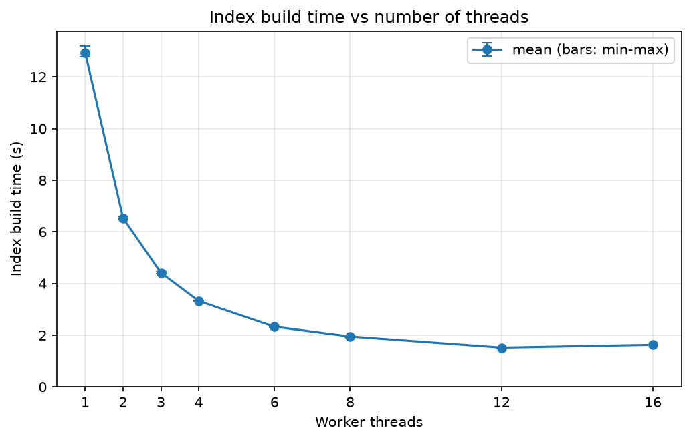

Дані з `bench/results/REPORT.md` (`index_build.csv`): датасет 20 000 документів, 3
виміряні побудови на кожне `p`, `T(p)` — `time_ms`, який повертає сервер.

| p | Середнє T(p), мс | Розкид (std), мс | S(p) | E(p) | e(p) |
|---:|---:|---:|---:|---:|---:|
| 1 | 12 938 | 220 | 1,00 | 1,00 | н/д |
| 2 | 6 529 | 55 | 1,98 | 0,99 | 0,009 |
| 3 | 4 413 | 28 | 2,93 | 0,98 | 0,012 |
| 4 | 3 320 | 12 | 3,90 | 0,97 | 0,009 |
| 6 | 2 326 | 7 | 5,56 | 0,93 | 0,016 |
| 8 | 1 948 | 19 | 6,64 | 0,83 | 0,029 |
| 12 | 1 519 | 15 | 8,52 | 0,71 | 0,037 |
| 16 | 1 627 | 6 | 7,95 | 0,50 | 0,067 |

Найкращий результат — 12 потоків (1 519 мс, 8,52×). Розкид між повтореннями малий
(std від 6 до 220 мс), тому відмінності між рядками значущі.

**Інтерпретація.** До 6 потоків масштабування майже лінійне (`E` ≥ 0,93): кількість
потоків збігається з числом фізичних ядер. Далі `E(p)` падає, бо потоки 7–12 — це
SMT-близнюки, що ділять з уже зайнятими ядрами виконавчі блоки та кеші, тому
додатковий потік дає значно менше за повноцінне ядро. Найкращий час — за 12 потоків
(усі логічні процесори); за 16 потоків побудова повільніша (1 627 мс): запущених потоків
більше, ніж логічних процесорів, виникають перепідписка й перемикання контексту.
Метрика Карпа—Флатта `e(p)` зростає з близько 0,01 до 0,067. Сталий `e` свідчив би про
фіксовану послідовну частину; зростання вказує на накладні витрати, що ростуть із числом
потоків (спільна пропускна здатність пам'яті й кешів, SMT, планування). Це узгоджується з
дизайном: основна робота (читання, токенізація, підрахунок термінів) виконується в кожному
потоці у власній хеш-таблиці без блокувань, злиття ділиться на 64 шарди, а координуючий
потік лише обходить каталог, тому велика послідовна частина не очікується. Спостереження
саме по собі не відокремлює пропускну здатність пам'яті від SMT; це гіпотези, узгоджені
з даними, а не доведені окремими вимірами.

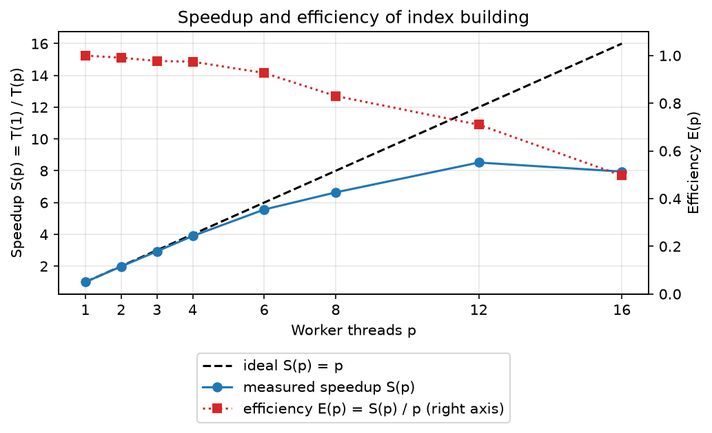

Прискорення зростає майже лінійно до 6 потоків (за кількістю фізичних ядер), далі
крива помітно положистіша; максимум — за 12 потоків (8,52×), а за 16 прискорення
падає до 7,95×.

### 4.5. Пропускна здатність від кількості клієнтів

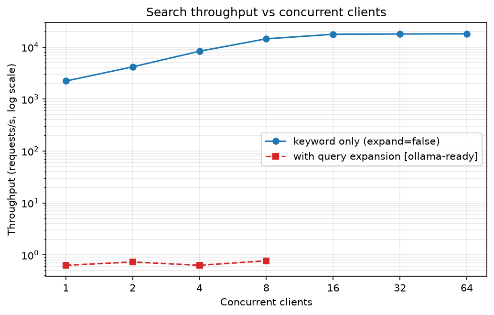

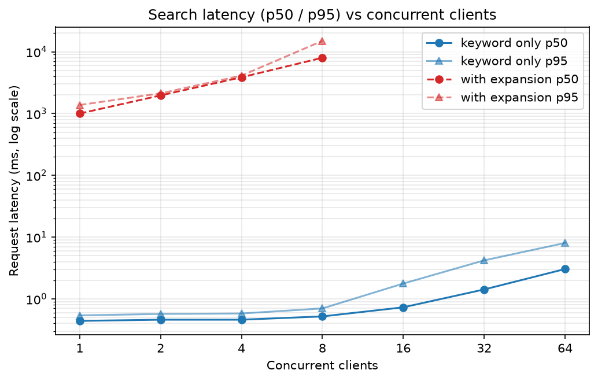

Джерела: `throughput_keyword.csv` (без розширення), `throughput_llm.csv` (з
розширенням), `loadgen_ceiling.csv` (стеля генератора); таблиці — у
`bench/results/REPORT.md`.

**Пошук без розширення** (`expand: false`, 15 с на рівень, помилок немає):

| Клієнти | Запити | запитів/с | p50, мс | p95, мс | p99, мс |
|---:|---:|---:|---:|---:|---:|
| 1 | 33 389 | 2 225,93 | 0,44 | 0,54 | 0,59 |
| 2 | 62 516 | 4 167,73 | 0,46 | 0,57 | 0,66 |
| 4 | 125 044 | 8 336,27 | 0,46 | 0,58 | 0,65 |
| 8 | 216 961 | 14 464,07 | 0,52 | 0,70 | 0,89 |
| 16 | 265 156 | 17 677,07 | 0,73 | 1,77 | 2,37 |
| 32 | 268 470 | 17 898,00 | 1,42 | 4,20 | 5,86 |
| 64 | 270 634 | 18 042,27 | 3,04 | 8,03 | 10,86 |

Пік — 18 042,3 запитів/с за 64 клієнтів; 95 % піку досягається за **16** клієнтів
(17 677 запитів/с). Далі пропускна здатність майже не росте, а p50 збільшується з 0,44
до 3,04 мс. **Обмеження методики:** генератор навантаження працював на тому самому ЦП,
що й сервер. Контрольний прогін на `GET /api/health` (64 клієнти) дав 46 509 запитів/с
(p50 1,17 мс; генератор використав 631,5 % одного ядра), тож генератор не був межею, але
забирав частину ядер, і справжня стеля сервера на окремій машині могла б бути вищою.

**Пошук з розширенням** (`expand: true`, Ollama, `llama3.2:1b` на CPU):

| Клієнти | Запити | запитів/с | p50, мс | p95, мс | llm | fallback |
|---:|---:|---:|---:|---:|---:|---:|
| 1 | 19 | 0,63 | 1001,01 | 1375,05 | 19 | 0 |
| 2 | 22 | 0,73 | 1968,51 | 2123,85 | 22 | 0 |
| 4 | 19 | 0,63 | 3862,31 | 4114,87 | 19 | 0 |
| 8 | 23 | 0,77 | 7997,71 | 15004,38 | 21 | 2 |

Пропускна здатність тримається на рівні 0,63–0,77 запитів/с, тоді як p50 зростає
приблизно лінійно (1,0; 2,0; 3,9; 8,0 с): один екземпляр Ollama виконує генерації
по черзі. За 8 клієнтів 2 з 23 відповідей досягли тайм-ауту 15 с і завершились
резервним режимом (`fallback`) — резервний механізм спрацював за призначенням.
Відношення пропускної здатності пошуку без розширення до пошуку з розширенням:

| Клієнти | без розширення, запитів/с | з розширенням, запитів/с | відношення |
|---:|---:|---:|---:|
| 1 | 2 225,9 | 0,63 | 3 533× |
| 2 | 4 167,7 | 0,73 | 5 709× |
| 4 | 8 336,3 | 0,63 | 13 232× |
| 8 | 14 464,1 | 0,77 | 18 785× |

Усього в прогоні з розширенням було 81 відповідь `llm` і 2 `fallback`; кількість запитів
на рівень мала (19–23), тому значення p95/p99 слід трактувати обережно.

### 4.6. Результати пошуку на тестових запитах

Таблиця з `bench/results/search_quality.md` (сирі дані — `search_quality.csv`); запит
виконується з `expand: false`, `limit: 3`, у кожного рядка показано три перші документи
(`doc_id`, `score`).

| # | Запит | Очікувана тема | Три перші результати (doc_id, score) | Результат |
|---:|---|---|---|---|
| 1 | `building` | architecture/* | architecture/doc_006240.txt (1.0); architecture/doc_008944.txt (0.999871); architecture/doc_006128.txt (0.998771) | PASS |
| 2 | `recipe` | cooking/* | cooking/doc_010547.txt (1.0); cooking/doc_008739.txt (0.998695); cooking/doc_010899.txt (0.998564) | PASS |
| 3 | `savings` | finance/* | finance/doc_019094.txt (1.0); finance/doc_007462.txt (0.998921); finance/doc_000630.txt (0.995356) | PASS |
| 4 | `molecule` | science/* | science/doc_016873.txt (1.0); science/doc_011913.txt (0.998927); science/doc_010265.txt (0.997999) | PASS |
| 5 | `software hardware` | technology/* | technology/doc_017852.txt (1.0); technology/doc_012716.txt (0.998692); technology/doc_007916.txt (0.998483) | PASS |
| 6 | `hail thunder` | weather/* | weather/doc_009119.txt (1.0); weather/doc_012575.txt (0.99778); weather/doc_014831.txt (0.9964) | PASS |
| 7 | `enterprise manager` | business/* | business/doc_000258.txt (1.0); business/doc_014562.txt (0.998858); business/doc_001634.txt (0.998632) | PASS |
| 8 | `desert meadow wetland` | environment/* | environment/doc_017285.txt (1.0); environment/doc_015301.txt (0.999877); environment/doc_001573.txt (0.998857) | PASS |
| 9 | `chord tune tempo` | music/* | music/doc_002616.txt (1.0); music/doc_006200.txt (0.999997); music/doc_010712.txt (0.99881) | PASS |
| 10 | `zxqvwk` | немає результатів | (немає) | PASS |

Пройдено **10 з 10** запитів. Очікувана тема — каталог словника, що містить слово (слова).

### 4.7. Аналіз вузьких місць

Якісний аналіз — `bench/ANALYSIS.md` (містить також короткий підсумок прогону 2026-11-21); виміряні числа наведено в розділах 4.3–4.6 і нижче.
Для побудови індексу в ній розглянуто такі кандидати (кожен має підтверджуватися
рядком таблиці або графіком, а не припущенням):

1. послідовна частина на координуючому потоці (обхід каталогу, постановка завдань);
2. диск і кеш сторінок ОС (холоста побудова прогріває кеш; у Docker Desktop том
   розташований у віртуальній машині);
3. пропускна здатність пам'яті (токенізація та хеш-таблиці);
4. суперництво за блокування шардів під час злиття (64 шарди, не більше 16 записувачів —
   очікується лише як пізній ріст `e(p)`);
5. гіперпотокова та перепідписка потоків (поведінка за межею фізичних ядер);
6. обмеження ЦП у Docker;
7. гранулярність завдань: кожна постановка проходить через `queueMutex` пулу.

Для пошуку: ядра ЦП; читання файлів для сніпетів на кожен результат (потокове, із
припиненням після збігу, тому довжина файлу впливає на нього слабше, ніж на побудову
індексу); кількість потоків вводу-виводу HTTP, у яких виконується весь пошук REST; JSON;
а за наявності розширення — один виклик Ollama
(сотні мілісекунд і більше), що блокує потік обробника, і те, що Ollama обробляє мало
запитів паралельно та на тих самих ядрах.

#### Відоме обмеження L1 та відхилена альтернатива

*Обмеження L1.* Усі маршрути REST виконуються в потоці вводу-виводу з'єднання, до якого
з'єднання прив'язує бібліотека (Crow) під час прийому. Довго утримують потік лише дві
операції: `POST /api/search` із викликом Ollama (до `OLLAMA_TIMEOUT_MS`, одночасно не більше
восьми) і `POST /api/index` (на весь час побудови, одна). Отже, одночасно зайнято не більше
дев'яти з принаймні шістнадцяти потоків. Запит `GET /api/health` або `GET /api/stats` на
з'єднанні, що опинилось на зайнятому потоці, чекає закінчення цієї операції (до `OLLAMA_TIMEOUT_MS` плюс до 2 с на власну перевірку Ollama, тобто близько 17 с за типових значень; для побудови — тривалість побудови плюс до 2 с); решта
відповідає за мілісекунди. Те саме стосується інших запитів і WebSocket-з'єднань на такому
потоці (L2). Це слід враховувати при інтерпретації викидів затримки в `bench/results/`.
Опис і межі наведено в `docs/API.md`, розділ 2.5. Дані прогону, що це підтверджують
(завислий Ollama, 16 пошуків і 24 запити стану: один запит стану чекав близько 16 с, решта
— мілісекунди), наведено в контракті; вони отримані під час розробки, не за методикою
розділу 4.2.

*Відхилена альтернатива.* Було реалізовано й виміряно інший дизайн: `POST /api/search` і
`POST /api/index` виконувалися в окремому пулі запитів, а відповідь завершувалась
пізніше з цього пулу. Він прибирав затримку стану (найповільніший запит стану 2,0 с — це
сам запит, що виконував перевірку, решта — мілісекунди; 5 прогонів). Але відкладені
відповіді в Crow призводили до використання пам'яті після звільнення (use-after-free), якого
вдавалося уникнути лише зверненням до приватного члена бібліотеки; довелось також
обходити дублювання заголовка `Connection`; пропускна здатність пошуку без розширення за
16 клієнтів на машині з 2 ядрами впала приблизно з 4870 до 4130 запитів/с (близько 14 %).
Тому зміну не прийнято: її немає в коді, а обмеження зафіксовано в контракті. Ці числа —
вимірювання під час розробки в пісочниці з 2 ядрами (запис № 16 у `docs/prompts.md`), а не
результат бенчмарка курсової роботи.

*Що потрібно, щоб зробити правильно.* HTTP-бібліотека з повноцінними асинхронними
відповідями (відповідь завершується з довільного потоку без доступу до внутрішніх
структур), або власна модель, де потоки вводу-виводу лише читають запит і віддають його в
пул, а запис відповіді повертається в потік з'єднання бібліотечними засобами.

#### Висновки за результатами прогону 2026-11-21

Машина: 6 фізичних ядер / 12 логічних потоків (розділ 4.3); джерело чисел —
`bench/results/REPORT.md`.

**Побудова індексу.** Прискорення зростає майже лінійно до 6 потоків (`E(6)` = 0,93),
далі повільніше: 6,64× за 8 і 8,52× за 12 потоків (найкращий результат); за 16
потоків — 7,95×, тобто повільніше, ніж за 12. Метрика Карпа—Флатта зростає з близько
0,01 (p = 2–4) до 0,067 (p = 16), а не залишається сталою. Отже, з причин 1–7 даними
підтверджуються: **5** (SMT і перепідписка: злам кривої за межею 6 фізичних ядер, гірший
час за 16 потоків, ніж за 12) і, у межах цих даних, загальне зростання накладних витрат
(пам'ять, кеші, планування — причина 3 можлива, але прямо не виміряна). Мала стала
послідовна частина (причина 1) допустима лише на рівні `e` ≈ 0,01 за p ≤ 4; вона не
пояснює падіння ефективності, бо `e` росте. Це узгоджується з дизайном: кожен потік
рахує терміни у власній хеш-таблиці без блокувань, злиття береться під блокування одного
з 64 шардів, а координуючий потік лише обходить каталог; суперництво за шардами
(причина 4) не виявлено як окремий ефект, бо крива не має різкого стрибка `e(p)` на
максимальних p. Причини 2 (диск), 6 (обмеження Docker: усі 12 логічних ЦП доступні) і 7
(гранулярність завдань) цими вимірами не розділяються й не доводяться.

**Пошук без розширення.** Пропускна здатність зростає майже лінійно до 8 клієнтів,
насичується за 16 (17 677 запитів/с, 95 % піку 18 042 запитів/с за 64), а p50 зростає з
0,44 до 3,04 мс — це черга до ЦП (замкнений цикл: затримка ≈ клієнти / пропускна
здатність). Генератор працював на тому самому ЦП: контрольний прогін на `/api/health`
досяг 46 509 запитів/с, тож не він був межею, але він конкурував із сервером за ядра.

**Пошук з розширенням.** Пропускна здатність плоска (0,63–0,77 запитів/с), p50 росте
приблизно лінійно з числом клієнтів (1,0; 2,0; 3,9; 8,0 с): Ollama обслуговує генерації
по черзі, тому вузьке місце — модель, а не потоки сервера. Точніше, ці дані підтверджують
послідовне обслуговування, але не розрізняють, чим саме воно зумовлене (одна модель на
CPU, налаштування паралелізму Ollama); це не досліджувалось окремо.

**Що не вдалося визначити.** Внесок диска/кешу сторінок, пропускної здатності пам'яті
та суперництва за шарди окремо — для цього потрібні додаткові вимірювання (профілювання,
лічильники), яких у прогоні немає.

---

## 5. Висновки

Числа взято з прогону бенчмарка на машині студента 2026-11-21 (`bench/results/REPORT.md`).

1. **Результат роботи.** Реалізовано контейнеризовану пошукову систему: власний пул
   потоків, власний шардований інвертований індекс, REST API і WebSocket за
   зафіксованим контрактом, розширення запитів через Ollama з резервним режимом, CLI та
   Web UI. Система запускається командою `docker compose up`.
2. **Паралельна побудова індексу.** З 1 потоком індекс будується 12 938 мс, з найкращою
   кількістю потоків (12) — 1 519 мс: прискорення `S` = 8,52, ефективність `E` = 0,71
   (на машині з 6 фізичними ядрами та 12 логічними потоками). Оцінка ефективності
   паралелізму: до 6 потоків масштабування майже лінійне (`E` ≥ 0,93), далі `E(p)`
   знижується, а `e(p)` зростає з близько 0,01 до 0,067 — тобто втрати зумовлені
   зростанням накладних витрат і апаратним обмеженням, а не сталою послідовною часткою.
3. **Вузькі місця.** Головна причина обмеження прискорення — апаратна: потоки 7–12 є
   SMT-близнюками ядер, що ділять виконавчі блоки та кеші, а 16 потоків (більше за 12
   логічних процесорів) дають перепідписку й перемикання контексту (1 627 мс проти
   1 519 мс на 12 потоках). Пошук без розширення обмежений ЦП (насичення за 16 клієнтів),
   пошук з розширенням — єдиним екземпляром Ollama (розділ 4.7).
4. **Потокобезпечність.** Індекс захищено поштардовими `shared_mutex` без вкладених
   захватів, пул потоків і сервіс покрито тестами; стрес-тести та ThreadSanitizer не
   виявили гонок: у середовищі розробки (Linux, 2 ядра, не на машині бенчмарка) обидва
   набори (134 тести) проходять у збірці з ThreadSanitizer без жодного попередження
   (розділ 4.1).
5. **Пошук під навантаженням.** Піковий RPS без розширення — 18 042 запитів/с (64 клієнти);
   95 % піку досягається вже за 16 клієнтів (17 677 запитів/с), далі зростає лише затримка
   (p50 з 0,44 до 3,04 мс). З розширенням пропускна здатність — 0,63–0,77 запитів/с за
   1–8 клієнтів (пік 0,77); відношення пошуку без розширення до пошуку з розширенням —
   від 3 533 до 18 785 разів (за 1 і 8 клієнтів відповідно).
   збільшує затримку та обмежує пропускну здатність через єдиний Ollama і блокування
   потоків обробників на час виклику.
6. **Якість пошуку.** Пройдено 10 з 10 тестових запитів (розділ 4.6). Датасет згенерований
   (словники за темами, розподіл, подібний до Ципфа), тому оцінка якості показує лише
   коректність роботи індексу і ранжування, а не якість пошуку на реальних текстах.
7. **Обмеження та можливі покращення.** Індекс зберігається лише в пам'яті і не будується
   автоматично при старті; сніпети читаються з диска на кожен запит (потоково, до
   заповнення вікна); відоме обмеження L1 (розділ 4.7); немає стемінгу;
   розширення не кешуються. Покращення (див. `bench/ANALYSIS.md`, розділ 5): обхід
   каталогу в окремому потоці, часткові індекси на потік зі злиттям по шардах, кеш
   сніпетів та розширень, швидший розподілювач пам'яті, `OLLAMA_NUM_PARALLEL` або GPU.

---

## Додаток А. Використані промпти

Розробку проєкту організовано за допомогою ШІ-агентів. Оркестратор (Claude) розбив роботу
на завдання й передавав кожне профільному субагенту. Усі промпти зберігаються дослівно у
`docs/prompts.md` (з другого промпту повний текст спочатку записувався у файл, а субагент
отримував однорядкове посилання на розділ, тому текст у файлі збігається з тим, що
виконував субагент). Нижче наведено перелік записів; повні тексти в цьому документі не
повторюються.

| № | Агент | Модель | Призначення | Результат |
|---|---|---|---|---|
| 1 | `api-contract` | opus | написати `docs/API.md` — єдине джерело істини для REST і WebSocket | прийнято |
| 2 | `concurrency-core` | opus | пул потоків, інвертований індекс, токенізатор, `IndexBuilder`, тести | прийнято (на той момент 51 тест; також під ThreadSanitizer) |
| 3 | `devops` | sonnet | Docker Compose, сервіси Ollama, генератор датасету | не виконано: субагента зупинив фільтр виводу API до створення файлів; повторено як № 4 |
| 4 | `devops` | sonnet | повтор завдання № 3 з уточненнями | прийнято (генератор запущено локально; збірку образу в пісочниці не запущено) |
| 5 | `backend-api` | sonnet | HTTP/WebSocket сервер, `SearchPipelineService`, клієнт Ollama | прийнято (на той момент 125 тестів; обидва набори чисті під ThreadSanitizer; димовий тест повторено) |
| 6 | `clients` | sonnet | CLI `./search` і Web UI | прийнято (CLI перевірено на живому сервері; логіку Web UI перевірено в jsdom, у реальному браузері не відкривалась) |
| 7 | `benchmark` | sonnet | скрипти вимірювань, графіки, чернетка аналізу | прийнято (скрипти перевірено на зразку з 2000 документів; реальні виміри виконує студент) |
| 8 | `concurrency-core` | opus | дострокове завершення при виділенні сніпетів | прийнято (на той момент 129 тестів; результат побайтно збігається з попередньою реалізацією) |
| 9 | `docs-writer` | sonnet | README, діаграми UML, ця пояснювальна записка | прийнято (числові результати вимірювань додає студент) |
| 10 | `verifier` | opus | незалежна перевірка з чистого клону: контракт, тести, клієнти, документація | прийнято (близько 150 перевірок; 10 зауважень передано на виправлення у № 11–13) |
| 11 | `api-contract` | opus | уточнення контракту після перевірки: межа одночасних розширень, місткість пулу WebSocket, метод HEAD | прийнято |
| 12 | `concurrency-core` | opus | обмеження пам'яті при повторних перебудовах індексу | прийнято (RSS після 10 перебудов 395 МБ замість 1916 МБ за вимірами субагента) |
| 13 | `backend-api` | sonnet | обмежувач розширень, швидка відповідь на помилку у WebSocket | прийнято (133 тести; обидва набори чисті під ThreadSanitizer) |
| 14 | `verifier` | opus | повторна перевірка виправлених зауважень | прийнято (F1–F6, F8–F10 підтверджено; пункти 1–30 контрольного списку пройдені; нове зауваження N1 передано на № 15, N3 виправлено оркестратором у `docs/API.md`, N2 залишено власнику репозиторію) |
| 15 | `backend-api` | sonnet | одноразова перевірка стану Ollama (single-flight) | прийнято (працює, 134 тести; наскрізний прогін усе ще показав один запит стану, затриманий за заблокованим потоком вводу-виводу, передано на № 16) |
| 16 | `backend-api` | sonnet | винести довгі запити з потоків вводу-виводу HTTP | не злито (прибирало викид затримки стану, але відкладені відповіді призводили до use-after-free у Crow, який обходився лише через приватний член бібліотеки, а пропускна здатність пошуку без розширення впала приблизно на 14 % на 2 ядрах; оркестратор відкотив зміну, а контракт тепер описує обмеження, № 17) |
| 17 | `api-contract` | opus | чесно описати межу затримки стану | прийнято (новий розділ 2.5 з обмеженнями L1 і L2; умовна межа для стану; переформульовано пункт 2a контрольного списку) |
| 18 | `docs-writer` | sonnet | синхронізація документації з фінальним кодом | прийнято (перший запуск було зупинено до змін файлів і повторено без змін) |
| 19 | `verifier` | opus | остаточна приймальна перевірка | прийнято (60 успішних, 1 невдала, 6 ризиків; усі стосуються формулювань у `docs/API.md` або документів, дефектів коду немає; передано на № 20 і № 21) |
| 20 | `api-contract` | opus | остаточні виправлення формулювань контракту | прийнято (змінено лише формулювання та пункти контрольного списку; формати, поля й коди без змін) |
| 21 | `docs-writer` | sonnet | остаточні виправлення за результатами перевірки | прийнято (виправлено шість неточних тверджень у документах) |
| 22 | `docs-writer` | sonnet | заповнення записки результатами локального бенчмарку | прийнято (усі числа взято з `bench/results`) |
| 23 | `docs-writer` | sonnet | оформлення розділу 2: рисунки UML у записці | прийнято |

Перелік складено за заголовками й рядками «Outcome» файлу `docs/prompts.md`; якщо рядок
змінився, оновіть таблицю.

### Промпт розширення запиту (надсилається серверу Ollama)

Константа `kExpansionPromptTemplate` у `server/include/search/ollama_client.h`; `{query}`
замінюється запитом користувача. Параметри виклику: `POST {OLLAMA_URL}/api/generate`,
`"stream": false`, `"format": "json"`, `"options": {"temperature": 0}`.

```
You are a search query expansion engine. Given a search query, list keywords and synonyms that are closely related to it.
Rules:
- English only.
- Each term is a single word or a very short phrase.
- At most 10 terms, most relevant first.
- Do not repeat the words of the query itself.
- No explanations, no extra text.
Answer only with a JSON object of this exact form: {"terms": ["term1", "term2"]}
Query: {query}
```
