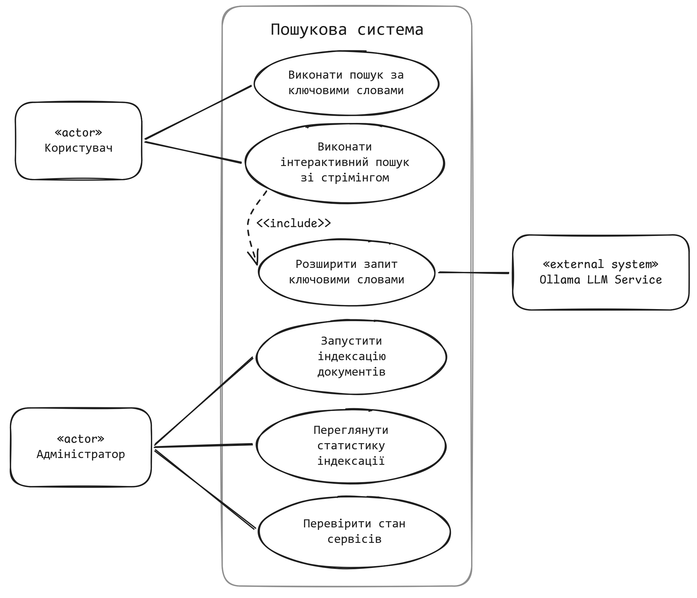
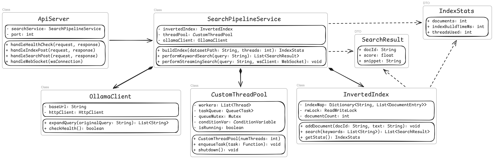
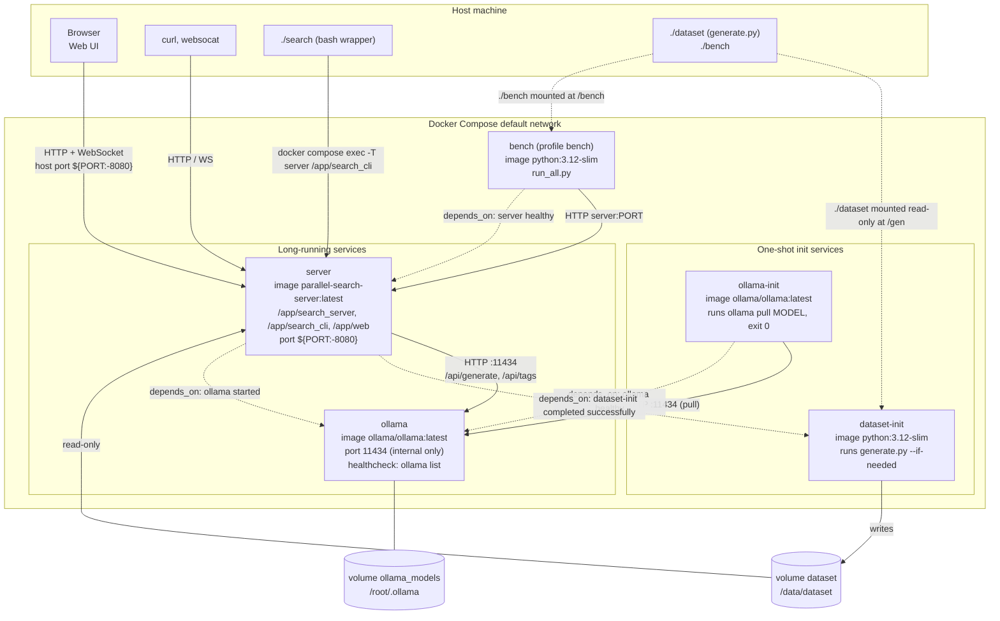
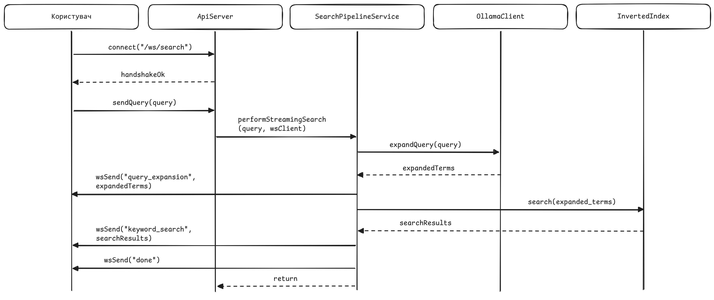
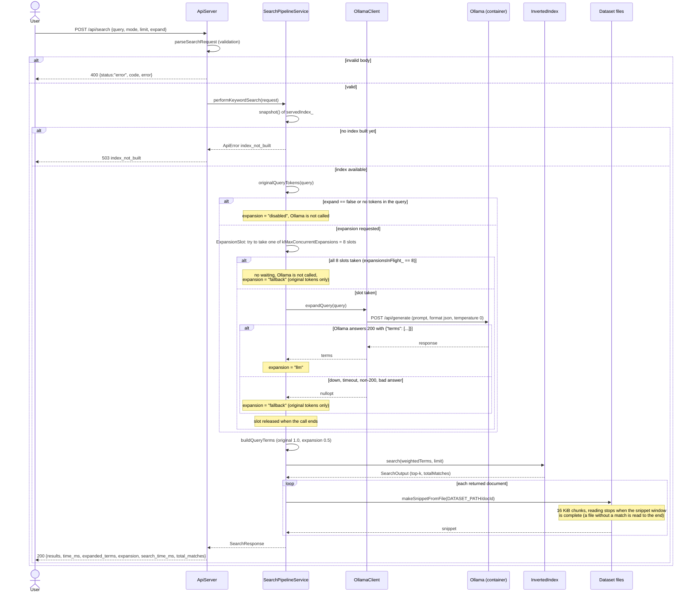
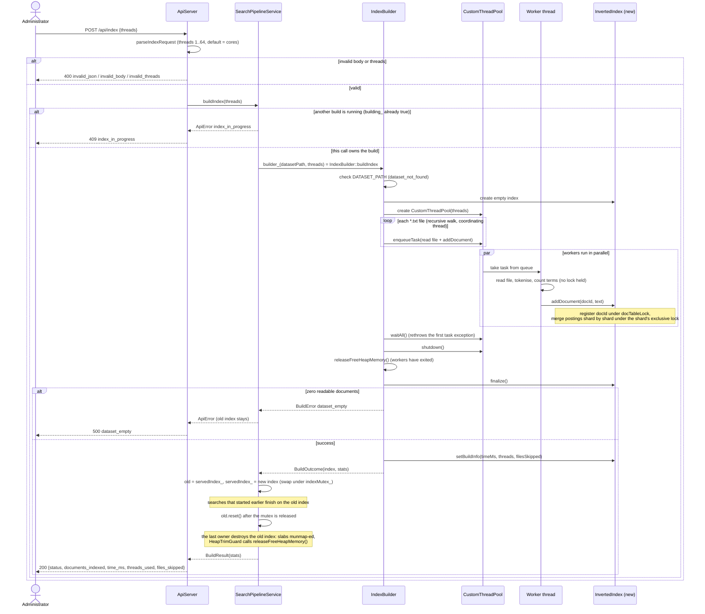
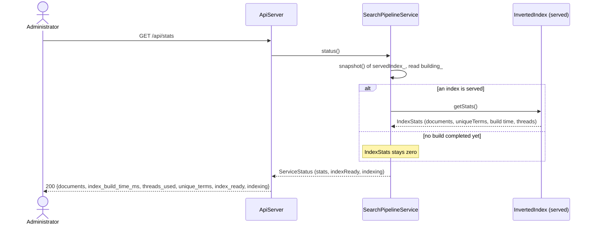
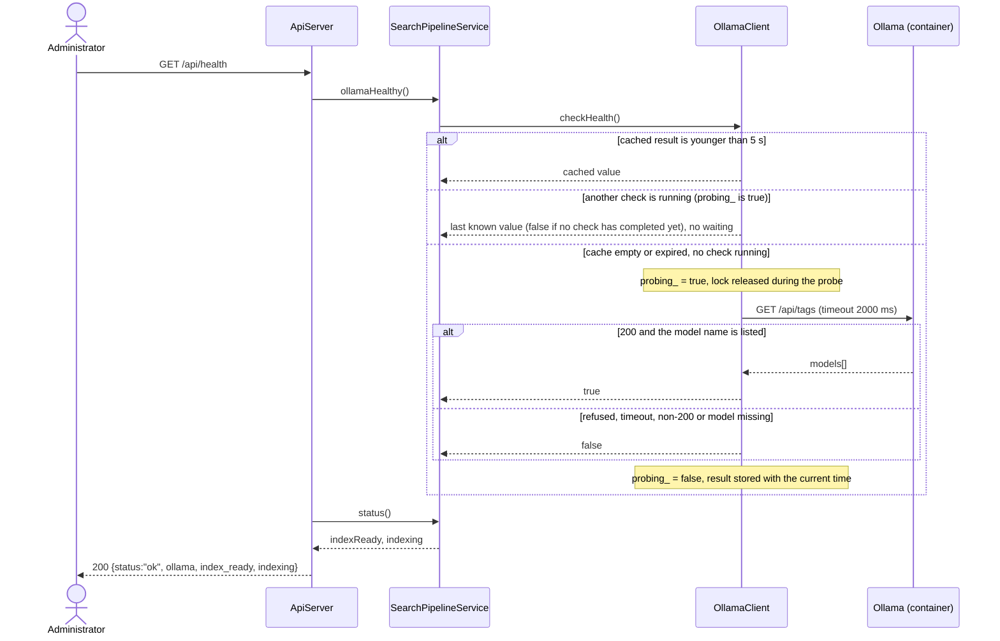

# UML diagrams

The assignment asks for use case, class, sequence (for every use case) and deployment
diagrams. Three diagrams were drawn by hand before the implementation (PNG, labels in
Ukrainian). The rest are Mermaid diagrams in this file (GitHub renders them), written
against the code in `server/`. Names are exactly the ones used in the code.

| Diagram | Form | Where |
|---|---|---|
| Use case | PNG | [section 1](#1-use-case-diagram) |
| Class (as designed) | PNG | [section 2](#2-class-diagram) |
| Class (matches the code) | Mermaid | [section 2.2](#22-class-diagram-matching-the-code) |
| Deployment (Docker Compose topology) | Mermaid | [section 3](#3-deployment-diagram) |
| Sequence: streaming search | PNG | [section 4.1](#41-interactive-search-with-streaming-websocket) |
| Sequence: keyword search (REST) | Mermaid | [section 4.2](#42-keyword-search-rest) |
| Sequence: build the index | Mermaid | [section 4.3](#43-build-the-index) |
| Sequence: index statistics | Mermaid | [section 4.4](#44-view-index-statistics) |
| Sequence: health check | Mermaid | [section 4.5](#45-check-service-health) |

## 1. Use case diagram

Actors: User, Administrator, the external system Ollama LLM Service. Use cases and
the endpoints that implement them:

| Use case (PNG) | Actor | Implemented by |
|---|---|---|
| Keyword search | User | `POST /api/search` |
| Interactive search with streaming | User | `WS /ws/search` (includes query expansion) |
| Expand the query with keywords | Ollama | `OllamaClient::expandQuery`, used by both search paths |
| Start document indexing | Administrator | `POST /api/index` |
| View indexing statistics | Administrator | `GET /api/stats` |
| Check service state | Administrator | `GET /api/health` |

Difference to the code: the PNG draws the `<<include>>` of query expansion only for
the streaming search. In the code the REST search also runs the expansion (unless
`"expand": false`), so the include arrow can be added to "Keyword search" too.

## 2. Class diagram

### 2.1 As designed (PNG)

### 2.2 Class diagram matching the code

```mermaid
classDiagram
  direction LR

  class ApiServer {
    -Config config_
    -shared_ptr~SearchPipelineService~ service_
    -unique_ptr~Impl~ impl_
    +handleHealthCheck() HttpReply
    +handleIndexPost(body) HttpReply
    +handleSearchPost(body) HttpReply
    +handleStats() HttpReply
    +handleRequest(method, path, body) HttpReply
    +handleStatic(path) HttpReply
    +handleWebSocket() void
    +run() void
    +stop() void
  }

  class Config {
    +int port
    +string datasetPath
    +string ollamaUrl
    +string ollamaModel
    +int ollamaTimeoutMs
    +string webRoot
  }

  class SearchPipelineService {
    -Config config_
    -shared_ptr~OllamaClient~ ollama_
    -IndexBuildFunction builder_
    -mutex indexMutex_
    -shared_ptr~const InvertedIndex~ servedIndex_
    -atomic~bool~ building_
    -atomic~bool~ stopping_
    -atomic~int~ expansionsInFlight_
    -CustomThreadPool webSocketPool_
    +kMaxConcurrentExpansions = 8$
    +buildIndex(threads) BuildResult
    +performKeywordSearch(request) SearchResponse_or_ApiError
    +performStreamingSearch(request, sink) void
    +handleWebSocketMessage(session, payload, isBinary) void
    +status() ServiceStatus
    +ollamaHealthy() bool
  }

  class WebSocketSession {
    -mutex mutex_
    -function sendText_
    -deque queue_
    -bool closed_
    -bool draining_
    +send(message) bool
    +close() void
    +isClosed() bool
  }

  class OllamaClient {
    -string baseUrl_
    -string model_
    -int timeoutMs_
    -mutex healthMutex_
    -bool probing_
    -bool hasHealth_
    -bool healthValue_
    +kHealthCacheTtl = 5 s$
    +kHealthTimeoutMs = 2000$
    +expandQuery(originalQuery) optional~vector~string~~
    +checkHealth() bool
    -probeHealth() bool
    +buildPrompt(query)$ string
    +buildGenerateRequestBody(model, query)$ string
    +parseGenerateResponse(body)$ optional~vector~string~~
    +tagsContainModel(tagsBody, model)$ bool
  }

  class IndexBuilder {
    +buildIndex(datasetPath, threads)$ BuildOutcome
    +makeDocId(file, root)$ string
  }

  class CustomThreadPool {
    -vector~thread~ workers
    -queue~Task~ taskQueue
    -mutex queueMutex
    -condition_variable conditionVar
    -condition_variable doneCondition
    -size_t pendingTasks
    -exception_ptr firstError
    -bool isRunning
    +CustomThreadPool(numThreads)
    +enqueueTask(task) void
    +waitAll() void
    +shutdown() void
    +size() int
  }

  class InvertedIndex {
    +kShardCount = 64$
    -array~Shard~ shards
    -shared_mutex docTableLock
    -vector~string~ docIds
    -atomic~uint64~ documentCount
    +addDocument(docId, text) void
    +search(keywords, limit) SearchOutput
    +getStats() IndexStats
    +documentFrequency(term) uint64
    +finalize() void
    +setBuildInfo(buildTimeMs, threadsUsed, filesSkipped) void
  }

  class PostingArena {
    +allocateChunk(capacity) uint32
    -vector~unique_ptr~Posting, SlabDeleter~~ slabs
    -uint32 usedInLastSlab
  }

  class memory_release {
    <<file memory_release.h>>
    +allocatePages(bytes) void*
    +freePages(address, bytes) void
    +releaseFreeHeapMemory() void
  }

  class Shard {
    +shared_mutex rwLock
    +PostingMap indexMap
    +PostingArena arena
  }

  class SearchResult {
    +string docId
    +double score
    +string snippet
  }

  class IndexStats {
    +uint64 documents
    +int64 indexBuildTimeMs
    +int threadsUsed
    +uint64 uniqueTerms
    +uint64 filesSkipped
    +bool indexReady
    +bool indexing
  }

  class SearchOutput {
    +vector~SearchResult~ results
    +uint64 totalMatches
  }

  class BuildOutcome {
    +BuildError error
    +string message
    +shared_ptr~InvertedIndex~ index
    +IndexStats stats
  }

  class WeightedTerm {
    +string term
    +double weight
  }

  class SearchRequest {
    +string query
    +int limit
    +bool expand
  }

  class ApiError {
    +int httpStatus
    +string code
    +string message
  }

  ApiServer --> SearchPipelineService : service_
  ApiServer --> Config
  ApiServer ..> SearchRequest : parseSearchRequest
  ApiServer ..> ApiError
  SearchPipelineService *-- CustomThreadPool : webSocketPool_
  SearchPipelineService o-- OllamaClient : ollama_
  SearchPipelineService o-- InvertedIndex : servedIndex_ (snapshot)
  SearchPipelineService ..> IndexBuilder : builder_
  SearchPipelineService o-- WebSocketSession : per connection
  SearchPipelineService ..> Config
  IndexBuilder ..> CustomThreadPool : new pool per build
  IndexBuilder ..> InvertedIndex : creates
  IndexBuilder ..> BuildOutcome
  BuildOutcome o-- InvertedIndex
  BuildOutcome *-- IndexStats
  InvertedIndex *-- Shard : 64
  Shard *-- PostingArena : arena
  PostingArena ..> memory_release : slabs via mmap / munmap
  InvertedIndex ..> memory_release : HeapTrimGuard trims in destructor
  IndexBuilder ..> memory_release : releaseFreeHeapMemory after build
  InvertedIndex ..> SearchOutput
  InvertedIndex ..> WeightedTerm
  InvertedIndex ..> IndexStats
  SearchOutput *-- SearchResult
```

Helper functions that are not classes: tokenizer (`forEachToken`, `tokenize`,
`buildQueryTerms`, `originalQueryTokens`, `isStopWord`), snippets (`makeSnippet`,
`makeSnippetFromFile`; the streaming state machine `SnippetScanner` and the
`TermSet` lookup are private to `snippet.cpp`, in an anonymous namespace, so they are
not drawn), request parsing (`parseIndexRequest`, `parseSearchRequest`,
`restErrorJson`, `webSocketErrorJson`), configuration (`loadConfig`,
`defaultWorkerThreads`). Other DTOs in `search_pipeline_service.h`: `BuildResult`,
`ServiceStatus`, `ExpansionStage`, `SearchStage`, `SearchResponse`, `PipelineOptions`.
`ExpansionSlot` (anonymous namespace in `search_pipeline_service.cpp`) is the RAII holder
of one expansion slot; it never waits.

### 2.3 PNG diagram vs code

Differences the student should apply when redrawing the PNG:

| Element | PNG | Code |
|---|---|---|
| `IndexBuilder` | absent | new class (`index_builder.h`): walks the dataset, creates a `CustomThreadPool` per build, calls `InvertedIndex::addDocument`; returns `BuildOutcome` (`BuildError`, message, index, stats) |
| `Config` | absent | new struct (`config.h`): `port`, `datasetPath`, `ollamaUrl`, `ollamaModel`, `ollamaTimeoutMs`, `webRoot`; read from environment variables |
| `WebSocketSession` | absent | new class: per-connection FIFO queue, `closed` flag and send serialisation; the connection is shared by every task that uses it |
| Request/error types | absent | `SearchRequest`, `IndexRequest`, `ApiError` (`request_validation.h`); `WeightedTerm` (`tokenizer.h`); `SearchOutput`, `BuildResult`, `ServiceStatus`, `ExpansionStage`, `SearchStage`, `SearchResponse` |
| `ApiServer` fields | `searchService`, `port` | `service_` (shared_ptr), `config_` (port lives in `Config`), pimpl `impl_` (Crow app, session table) |
| `ApiServer` methods | `handleHealthCheck(request, response)`, `handleIndexPost(request, response)`, `handleSearchPost(request, response)`, `handleWebSocket(wsConnection)` | handlers take the body string and return `HttpReply` (no socket types, unit-testable): `handleHealthCheck()`, `handleIndexPost(body)`, `handleSearchPost(body)`, `handleStats()`; added `handleRequest`, `handleStatic`, `run`, `stop`. `handleWebSocket()` has no argument: it registers the `/ws/search` route with open/message/close callbacks |
| `SearchPipelineService` fields | `invertedIndex`, `threadPool`, `ollamaClient` | `servedIndex_` is a `shared_ptr<const InvertedIndex>` swapped under `indexMutex_` (not owned for life); `ollama_`; `builder_`; `webSocketPool_` is the pool for WebSocket queries only; `building_`, `stopping_`, `config_`; `expansionsInFlight_` with the constant `kMaxConcurrentExpansions = 8` (load shedding of Ollama calls) |
| `buildIndex` | `buildIndex(datasetPath, threads): IndexStats` | `buildIndex(int threads): BuildResult`; the dataset path comes from `Config`; error 409/500 is returned in `BuildResult::error` |
| `performKeywordSearch` | `(query: String): List<SearchResult>` | `(const SearchRequest&): variant<SearchResponse, ApiError>`; `SearchResponse` holds the expansion stage and the search stage |
| `performStreamingSearch` | `(query, wsClient: WebSocket): void` | `(const SearchRequest&, const MessageSink&): void`; a `MessageSink` is a function that sends one text frame and returns false when the connection is gone. WebSocket frames enter through `handleWebSocketMessage(session, payload, isBinary)` |
| Pool ownership | `SearchPipelineService` composes `CustomThreadPool` | the service owns a pool only for WebSocket queries; index builds create their own pool inside `IndexBuilder::buildIndex` |
| `OllamaClient` fields | `baseUrl`, `httpClient` | `baseUrl_`, `model_`, `timeoutMs_`, health cache (`healthMutex_`, `probing_`, `hasHealth_`, `healthValue_`, `healthAt_`); no stored client: a `httplib::Client` is created per call |
| `OllamaClient` methods | `expandQuery(originalQuery): List<String>`, `checkHealth(): boolean` | `expandQuery` returns `optional<vector<string>>` (`nullopt` = failure -> fallback); `checkHealth` caches for 5 s and lets only one probe run at a time (`probing_`; other callers get the last known value); added static helpers `buildPrompt`, `buildGenerateRequestBody`, `parseGenerateResponse`, `tagsContainModel` |
| `CustomThreadPool` | `workers`, `taskQueue`, `queueMutex`, `conditionVar`, `isRunning`; `enqueueTask`, `shutdown` | same plus `doneCondition`, `pendingTasks`, `firstError`; added `waitAll()` and `size()`; `shutdown()` drains the queue; a task exception is stored and rethrown by `waitAll()`. `enqueueTask(Task)` with `Task = std::function<void()>` |
| `InvertedIndex` fields | `indexMap: Dictionary<String, List<DocumentEntry>>`, `rwLock`, `documentCount` | `shards` = 64 x `Shard` (each has its own `rwLock` and `indexMap`, postings are `{doc, count}` in a per-shard arena); `docIds` + `docTableLock`; `documentCount` is atomic; build info atomics, `finalized` |
| `InvertedIndex` methods | `addDocument(docId, text)`, `search(keywords: List<String>): List<SearchResult>`, `getStats()` | `search(const vector<WeightedTerm>&, limit): SearchOutput` (weights 1.0 original / 0.5 expansion, `totalMatches`); added `documentFrequency`, `finalize`, `setBuildInfo`, `getDocumentCount` |
| `SearchResult.score` | `float` | `double` (rounded to 6 decimals, clamped to [0.000001, 1.0]) |
| `IndexStats` | `documents`, `indexBuildTimeMs`, `threadsUsed` (int) | `documents` (uint64), `indexBuildTimeMs` (int64), `threadsUsed` (int) plus extra `uniqueTerms`, `filesSkipped`, `indexReady`, `indexing` |
| Memory release | absent | free functions in `memory_release.h`: `allocatePages` / `freePages` (posting slabs via `mmap` / `munmap`) and `releaseFreeHeapMemory` (`malloc_trim`); called from `InvertedIndex` (`HeapTrimGuard`, slab deleter) and `IndexBuilder::buildIndex` |
| Snippets | absent | free functions `makeSnippet`, `makeSnippetFromFile` (`snippet.h`); the file is read in 16 KiB chunks and reading stops when the snippet is complete |
| Relations | `SearchPipelineService` composes `InvertedIndex`, `OllamaClient` | the service holds `OllamaClient` by shared pointer (injectable for tests) and the index as a swapped snapshot; `IndexBuilder` creates the index |

## 3. Deployment diagram

UML has no dedicated Docker notation, so this is a Mermaid flowchart: nodes are
containers (Compose services), cylinders are named volumes, arrows show who talks to
whom. Source: `docker-compose.yml`.

Notes on the topology:

- Only `server` publishes a port. `ollama` is reachable only inside the Compose
  network (`OLLAMA_URL=http://ollama:11434`).
- `server` depends on `ollama` with `service_started`, not on the model: `/api/health`
  returns 200 with `"ollama": false` while the model is downloading.
- `server` waits for `dataset-init` to complete successfully; `ollama-init` is not a
  dependency of anything.
- `server` has a healthcheck (`curl /api/health`); `ollama` has one (`ollama list`).
- The root `Dockerfile` has two stages (`build`: GCC 13, CMake, Ninja; `runtime`:
  Ubuntu 24.04 with curl). Both Ubuntu images support amd64 and arm64.

## 4. Sequence diagrams

### 4.1 Interactive search with streaming (WebSocket)

The PNG shows the logical flow. Where the code adds detail (all in
`search_pipeline_service.cpp` and `api_server.cpp`):

- On connect, `ApiServer` creates a `WebSocketSession` for the connection.
- `onmessage` does not run the pipeline. It calls
  `SearchPipelineService::handleWebSocketMessage`, which appends the frame to the
  session queue and makes sure one drain task is scheduled on `webSocketPool_`.
  Queries of one connection are therefore processed in order and never interleaved;
  different connections run in parallel.
- Fast error path: if the session is idle (no query running or queued) and the frame
  is invalid (binary frame, bad JSON, bad fields), `handleWebSocketMessage` sends the
  `error` message at once on the connection's I/O thread and does not queue it. In every
  other case `processFrame` parses and validates the frame on a pool worker, so an
  invalid frame produces a single `error` message in its FIFO position. A valid frame
  goes to `performStreamingSearch(request, sink)`.
- `query_expansion` is sent before the keyword search starts; `done` is the last
  message. If no index is built, a single `error` (`index_not_built`) is sent.
- A frame above 65 536 bytes closes the connection with code 1009.

### 4.2 Keyword search (REST)

The whole handler runs on the HTTP I/O thread of the connection (docs/API.md section 2.5).

### 4.3 Build the index

### 4.4 View index statistics

### 4.5 Check service health

## 5. Gaps

- Known limitation L1 (docs/API.md section 2.5) is not drawn: a connection bound to an
  I/O thread that is busy with an expansion call or a build waits until that operation
  ends. All sequence diagrams of the REST routes run on that I/O thread.
- The PNG class diagram and the PNG use case diagram are not updated; section 2.3
  lists what to change. A sequence diagram for the streaming search exists only as the
  original PNG (section 4.1 describes the code differences in text).
- The Mermaid deployment diagram is a flowchart, not UML component notation; redraw it
  in the tool used for the other PNGs if a strictly UML deployment diagram is required.
